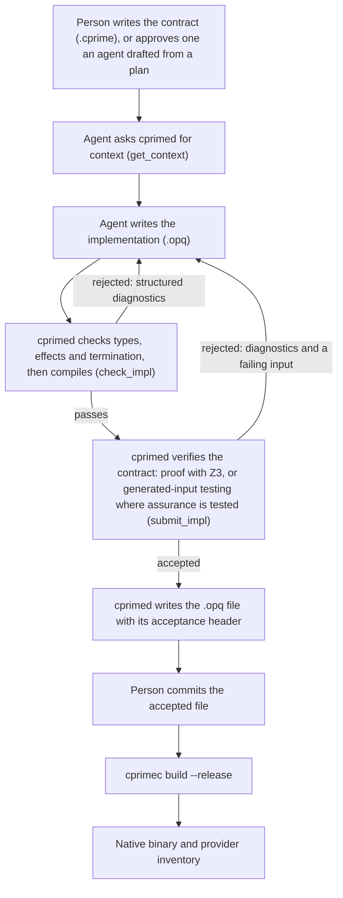

# Why C′ is an AI-native compiler

| Field | Value |
|---|---|
| Audience | Anyone new to C′, technical or not |
| Date | 2025-12-20 |
| Sources | `docs/cprime-concept.md`, `docs/design/cprime/` (HLD revision 0.6.0) |

## The short version

Most programming languages were designed for people who write code and read it. C′ is designed for a different division of labour: **people say what a program must do, and AI agents write the code that does it.** The compiler then checks the AI's work and accepts it only once it has been shown to keep every promise the person wrote down.

That is what "AI-native" means here. AI support isn't bolted onto an existing language; the whole language and compiler are shaped around a person and an AI working together, and around the fact that the AI's code is not meant to be read line by line.

The person does not even have to type the promises themselves. An AI agent can draft them from an agreed plan, and the person reviews and approves the draft. What matters is that the thing the person has to read and sign off is short and says only *what* the program must do, never *how*.

## How it works, in plain words

C′ splits every program into two kinds of file:

- **The contract (`.cprime`), owned by a person.** A person writes it, or reviews and approves one an AI agent drafted from a plan. It describes the data, what a function is allowed to touch (the clock, a source of random numbers, a cryptography library), what must be true before it runs, and what must be true of its answer. It reads like a precise specification.
- **The implementation (`.opq`), written by an AI agent.** A compact form designed for machines to write. It doesn't repeat the types or permissions from the contract, so it cannot quietly disagree with them.

A compiler service, `cprimed`, keeps running in the background. The AI sends it an implementation; within milliseconds to a few seconds, `cprimed` answers either "accepted" or "rejected, and here is exactly why". Only accepted code is saved to disk, so version control records every acceptance.

The diagram below shows one round of work: a person writes or approves the promise, the agent keeps trying until the compiler accepts its code, and only then does the code reach version control and the finished program.

## Where contracts come from

Many teams already work in a *spec-driven* way: before any code is written, the change is captured as a plan or specification, an AI agent works from that plan, and a person reviews the result. CSPA is one such process. It moves each change through fixed steps (gather evidence, reason about it, write the plan, change the code, reconcile plan and code, review), and every change to shared state waits for a person to approve it.

C′ fits this way of working, and changes where the person's review lands:

1. The plan is agreed, as it would be in any spec-driven process.
2. An AI agent turns the plan into a `.cprime` contract: the data types, the capabilities each function may use, and its `requires` / `ensures` promises.
3. A person reviews the contract against the plan and approves it. This is the review that matters (ADR-046).
4. An agent writes the `.opq` implementation, and `cprimed` accepts it only once it has shown that the implementation keeps the approved contract.

With a traditional language, the same process ends with the agent generating code straight from the plan, and the engineer has to read that code to decide whether it does what the plan said. The engineer has to hold control flow, error paths, memory handling and every outside call in their head at once, and the amount of code grows with every change.

With C′, the engineer reviews the contract instead. A `.cprime` file has no control flow, no memory handling and no hidden calls: it lists the data, what each function is allowed to touch, and what must be true before and after it runs. Comparing that against the plan is a much smaller and more focused task than reading an implementation, so the engineer carries less in their head and is more likely to notice what is wrong or missing. Checking that the code matches the contract is the compiler's job, not theirs.

## The top five benefits compared with traditional languages

### 1. People review promises, not code

In a traditional language, the safety net for AI-written code is a person reading every line. That doesn't scale: AI writes code faster than anyone can review it, and plausible-looking code can still be wrong.

In C′, the person's job moves to the contract: a short statement of what the code must guarantee. The code itself is checked by the compiler against that contract. The compiler also warns when part of a result is not covered by any promise, so gaps in the contract show up instead of hiding.

This holds whether the person wrote the contract or an agent drafted it from a plan. Either way the engineer reviews a short, declarative document instead of a large body of code, which takes far less mental effort and makes their review more reliable.

### 2. "Proved", not just "tested"

Traditional languages check that code is well formed; whether it is *correct* is left to tests, which only check the cases someone thought of.

C′ tries to **prove** the contract holds for every possible input, using a mathematical solver (Z3). If it finds an input that breaks a promise, it hands the AI that exact input as a counterexample. Where a proof isn't practical and the contract allows it, C′ falls back to running the code against thousands of generated inputs, and records honestly that the result is "tested" rather than "proved". Every accepted file states which level of evidence it earned.

### 3. A feedback loop built for machines

Compilers for traditional languages print error messages for people to read. C′ answers in structured data (JSON) that an AI tool can act on directly: which part of the code is wrong, which promise failed, and a concrete failing input. It is available both as an API and as tools an AI assistant can call (MCP).

It is also fast. Quick checks are designed to answer in about 5 to 20 milliseconds and full verification in about 2 seconds, so an agent can try, learn and retry many times in the time a person would take to read one error.

### 4. Memory safety without the paperwork

Languages like C and C++ leave memory mistakes to the programmer. Rust prevents them, but asks the programmer to annotate who owns each piece of data and for how long, which is hard for people and a common failure point for AI.

C′ gets memory safety a different way: values never change once created, and the compiler inserts the memory bookkeeping itself. The AI never writes an ownership annotation. Because values cannot change, there are no hidden data races or dangling pointers to reason about either.

### 5. Code can only touch what it was allowed to touch

In most languages, any function can quietly open a network connection, read a file or call outside code. Finding out what a piece of code *might* do means reading all of it.

In C′, every side effect (reading the clock, generating random numbers, calling a cryptography library, anything that reaches the outside world) belongs to a named capability. A function may use only the capabilities its contract lists, and the compiler checks this before the code is accepted. AI-written code cannot call foreign code directly; outside libraries are wrapped as declared, statically linked providers. C′ also proves that code finishes, unless the contract explicitly allows it to run forever.

## Why C′ is an efficient compiler for AI code generation

An AI agent writes code by trying, getting feedback and trying again. What makes a compiler efficient *for an agent* is therefore not only how fast the finished program runs, but how little each round trip costs: in waiting time, in words the model has to read and write, and in work the compiler repeats. C′ is designed to keep all three small.

### The agent writes less

The person's contract already states the types, the permitted capabilities and the promises. The agent's `.opq` file never repeats them: parameter types, return type and effects are not restated, and names from the current module can be written without their full path. An implementation is one short bracketed expression per file; the speed targets below are set for implementations of up to 200 compiled instructions. Fewer words written means fewer model tokens spent per attempt. The design's own hypothesis is at least 40% fewer tokens than the same task in Rust; that is a target to be measured on a 50-task corpus (G9), not yet a result.

### Answers come back in milliseconds

`cprimed` stays running between requests and keeps what it has already worked out in memory, like a cache. Before each request it checks which files on disk changed (by size and modification time) and re-reads only those (ADR-030). The targets for a single implementation are:

| Check | What it covers | Target |
|---|---|---|
| T0 | Parsing, types, effects, termination | 5 ms or less |
| T1 | Compile to machine code (JIT) | 20 ms or less |
| T2 | Prove the contract with the solver | 250 ms per promise, 2 s per submission |
| T3 | Generated-input testing, where allowed | 10,000 runs in 5 s or less |

So an agent can run a cheap check (`check_impl`) many times while drafting and pay for full verification (`submit_impl`) only when it thinks it is done. These are design targets (G5); they are measured as the compiler is built.

### Feedback the agent can act on first time

A rejection is structured data, not prose: a named diagnostic kind (for example `TypeMismatch`, `UnauthorizedEffect`, `ContractViolation`), where in the code it applies, and, for a broken promise, a concrete input that breaks it. The agent does not have to interpret an error message or guess what the compiler meant, which cuts the number of failed retries.

### The compiler never re-does work it has already done

- **Definitions are identified by their meaning.** Each definition's identity (`DefId`) is a hash of its content, so renaming a local variable or moving text around does not change it, and unchanged definitions are reused rather than re-checked (ADR-004).
- **Proofs are local.** When one implementation calls another spec, the proof uses the callee's contract, never its code (ADR-033). Proving one function costs the same however large the program around it grows.
- **Evidence is stored, not recomputed.** Each accepted file records the evidence it earned (`proved` or `tested`) and a hash of everything its proof depended on (ADR-031). If a contract changes, only the implementations that relied on it are marked stale; everything else stays accepted without being checked again.

### Several agents can work at once

Each agent session gets its own `cprimed`. They share the project's files and collide only when two try to save the same file, which a write lock and a conflict check catch (A-3). Because verification is local to each implementation, agents working on different specs do not slow each other down.

### The finished program is meant to be fast too

Release builds are compiled ahead of time through LLVM into a native binary. The target is to run within twice the time of hand-written Rust on the benchmark suite (G10). Release binaries can also spread work across CPU cores with `par_map`, which applies one spec to every element of a list on several worker threads, with each worker's data copied into its own memory so no locking is needed (ADR-044). The result is always the same as running the list in order. Both the 2× target and the multi-core speed-up are measured and reported, whether or not they are met.

## Where C′ sits among programming paradigms

A *paradigm* is a family's basic idea of what a program is. In procedural languages (C, Pascal) a program is a sequence of instructions that change stored values. In object-oriented languages (Java, C#) it is a set of objects that hold state and send each other messages. In functional languages (Haskell, OCaml) it is a set of functions that turn input values into output values. In declarative languages (SQL, Prolog) it is a description of the result you want, and the system works out how to get it.

C′ doesn't fit any one of these, because it is two languages joined by a contract, and each half belongs to a different family.

### The contract (`.cprime`) is declarative

A `.cprime` file never says *how* to compute anything. It declares data types, capabilities, and `requires` / `ensures` clauses: what must be true before a function runs and what must be true of its answer. This puts it in the tradition of *design by contract* and verification languages such as Eiffel, SPARK and Dafny, with one difference: in those languages the person writes both the contract and the code beneath it, while in C′ the person writes or approves only the contract.

### The implementation (`.opq`) is functional, with tight limits

The `.opq` half is plainly in the functional family:

- **Values never change.** There are no assignments, no mutable variables and no mutable references (ADR-039). Updating something means returning a new value. Under the hood the compiler reuses the memory in place when nothing else refers to it.
- **Everything is an expression.** A body is nested `let`, `match` and calls written in a Lisp-like bracketed syntax, and it produces one value. There are no statements.
- **Repetition is recursion.** There is no loop construct (ADR-024, ADR-038). Every recursive function states a measure that must shrink on each call, so the compiler can prove it finishes.
- **Data is built from records and sum types** (a sum type is a value that is exactly one of several named variants), and is taken apart with a `match` that must cover every variant. Failure comes back as a `Result` value. There are no exceptions.
- **Side effects are tracked in the types.** Every effect belongs to a named capability, and the compiler checks that a function uses only the ones its contract grants. This is close to the *effect systems* of research languages such as Koka, except that handlers come from the host and are bound in `.cprime`. `.opq` code cannot define them.

It is also more restricted than mainstream functional languages. In v1, functions are not values: you cannot pass a function as an argument or build a closure (SA-12). That makes v1 a *first-order* functional language. Function values typed by a contract, and later closures, are planned after v1 (ADR-037).

### What C′ deliberately is not

- **Not procedural.** Nothing in `.opq` is "do this, then change that". Reusing a `let` name creates a new binding; it does not overwrite the old one.
- **Not object-oriented.** There are no classes, no inheritance, no methods attached to data and no hidden state. Data and behaviour are kept apart. Calls through a vtable (choosing at run time which code runs) were rejected because such a call has no single contract to verify against (ADR-036). The planned replacement is interfaces whose operations carry laws, dispatched at compile time.
- **Not logic programming.** C′ uses a solver (Z3) to *check* programs, but programs don't run by search. The solver verifies; it never executes.

### So what is it?

C′'s real novelty is not in either half. It is in how the work is split between people, AI and compiler:

| | Traditional paradigms | C′ |
|---|---|---|
| What a person writes | The program | The promises the program must keep, or nothing if an agent drafts them from a plan |
| What a person reviews | The program, line by line | The promises, against the plan |
| Who writes the executable code | A person | An AI agent |
| Who reads the executable code | People, in review | The compiler, by proof or generated tests |
| What "the program is correct" means | It passed the tests someone wrote | It earned a recorded evidence level (`proved` or `tested`) against its contract |
| What a function's identity is | Its name and file location | A hash of its meaning (`DefId`), so renaming a local variable changes nothing |
| How the compiler talks back | Error text for people | Structured data, with a failing input, for agents |

If it needs a label, C′ is a **contract-first, verification-driven** language: a declarative specification language for people, sitting on a first-order, pure, effect-tracked functional core written by machines. The functional core isn't the point. It is chosen because immutable values and explicit effects are what make automatic proof practical. Mutation, shared state and hidden effects are exactly what solvers struggle to reason about. The paradigm, in the deeper sense, is the loop: a person states intent, an agent proposes code, and the compiler decides whether the evidence is good enough.

## What is not claimed

C′ is honest about its limits:

- **It guarantees only what the contract says.** A property missing from the contract is not checked. Writing good contracts remains a human responsibility.
- **It does not check the contract against the plan.** When an agent drafts a contract from a plan, `cprimed` proves the code keeps that contract, not that the contract matches the plan. The person's review of the contract is what closes that gap, so it cannot be skipped.
- **Three key claims are still to be measured.** That AI implementations in C′ use at least 40% fewer model tokens than the same programs in Rust, that release programs run within twice the time of hand-written Rust, and how much `par_map` speeds programs up on several cores. The project plan measures all three and reports the result whether or not it holds.
- **The first version is deliberately narrow.** Its only parallelism is in release builds: `par_map`, and servers that run each request as a separate task on worker threads with no shared memory; programs cannot start threads or tasks of their own, no mutable references and no loops (repetition is written as recursion). The reasons, and the plan for matching the programs Rust can express after v1, are recorded in `docs/design/cprime/09-decisions.md` (ADR-034 to ADR-043, ADR-051).

## In one sentence

C′ turns "trust the AI, then review its code" into "write down what you need, and let the compiler prove the AI delivered it".
