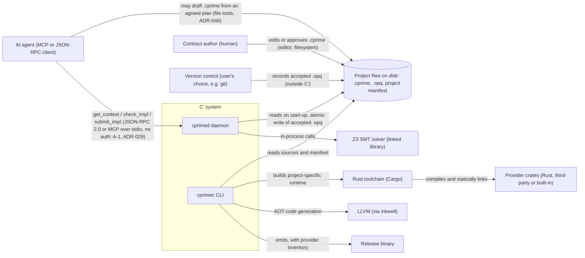

# C′ — System Context

> **Mode:** draft
> **Generated from:** inline context — `docs/cprime-concept.md` (Draft, revision 2)
> **Revision:** 0.12.0
> **Last updated:** 2025-12-20

## Context diagram

The trust boundary is the local user account (A-1): `cprimed` serves local clients only and performs no authentication in v1. Inside the program being compiled, the trust boundary is the provider boundary — `.opq` code can reach the outside world only through capability operations implemented by statically linked providers.

## External actors and neighbouring systems

- **Contract author (human)** — owns the `.cprime` files: types, capabilities, specs, policy, entry point and bindings. Writes them, or reviews and approves ones an agent drafted from an agreed plan, before any implementation is written against them (ADR-046). Does not review `.opq` line by line. **Interaction:** edits files on disk with any editor; no direct RPC interaction; `cprimed` picks up edits before each request (ADR-030).
- **AI agent** — writes `.opq` implementations against a spec. May also draft `.cprime` files from an agreed plan with its host's file tools, for a person to approve; `cprimed` offers no request for this (ADR-046). **Interaction:** JSON-RPC 2.0 methods or the equivalent MCP tools on `cprimed`; starts `cprimec daemon` and talks to the resulting `cprimed` over stdio (ADR-029); no authentication (A-1); request/response, agent-initiated.
- **Project files on disk** — authoritative store for `.cprime`, `.opq` and the project manifest. **Interaction:** `cprimed` reads all sources on start-up and writes an accepted implementation by temporary-file-then-rename; `check_impl` never writes; rejected submissions are never written.
- **Version control** — records every accepted implementation because each acceptance is one file write. **Interaction:** none from C′; the user operates it (A-12).
- **Provider crates** — Rust crates depending on `cprime-provider`, each implementing one capability. Includes the four built-ins (`host::Crypto`, `host::Clock`, `host::Random`, `host::Log`). **Interaction:** compiled and statically linked by Cargo into the project-specific runtime; called in-process.
- **Rust toolchain (Cargo)** — builds the project-specific runtime when the provider list or a provider crate changes. **Interaction:** `cprimec` invokes it as a local subprocess (A-11).
- **Z3** — SMT solver used for T2 proof obligations. **Interaction:** in-process through the `z3` crate.
- **LLVM** — release code generation. **Interaction:** in-process through `inkwell`, invoked by `cprimec` for AOT builds.
- **Release binary** — the artefact `cprimec` produces; runs single-threaded with the statically linked providers and the configured CPU/memory limits. **Interaction:** started by whoever deploys it; it reads its entry arguments as JSON on stdin and writes its result as JSON on stdout (`08-interfaces.md`).
