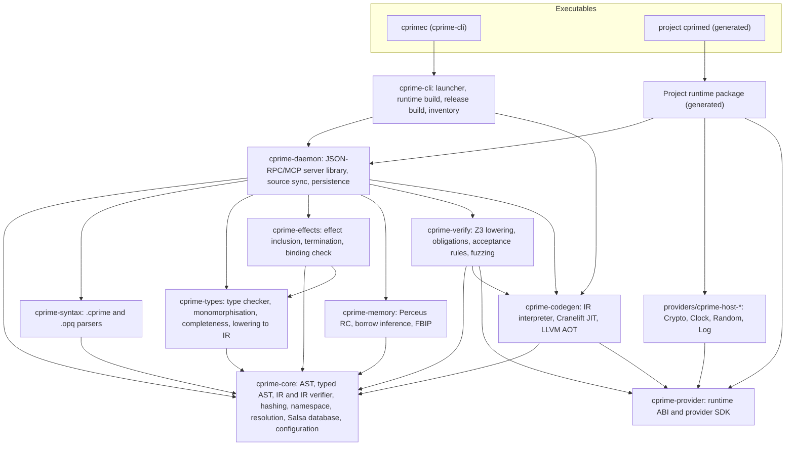

# C′ — System Architecture

> **Mode:** draft
> **Generated from:** inline context — `docs/cprime-concept.md` (Draft, revision 2)
> **Revision:** 0.12.0
> **Last updated:** 2025-12-20

## Component diagram

The compiler is a Cargo workspace of ten crates (Rust 2024 edition) plus four built-in provider crates. `cprimec` is the `cprime-cli` binary. `cprime-daemon` is a library; each project's `cprimed` executable is generated by the runtime build (ADR-032).

## Pipeline

Every submission travels the same stages; the tier names the latency budget.

| Tier | Stages | Crates | Run by |
|---|---|---|---|
| T0 | Parse → resolve names → type-check → effect-check → termination check → completeness check | `cprime-syntax`, `cprime-core`, `cprime-types`, `cprime-effects` | `check_impl`, `submit_impl` |
| T1 | Lower to C′-IR → IR verifier → Perceus RC and FBIP → IR verifier → Cranelift JIT | `cprime-core`, `cprime-memory`, `cprime-codegen` | `check_impl`, `submit_impl` |
| T2 | Lower `requires` + IR + `ensures` to Z3 → one obligation per `ensures` clause, trap site, call precondition (ADR-033) and `decreases` clause → obligations solved in parallel under the per-submission budget (ADR-025) | `cprime-verify` | `submit_impl` |
| T3 | Fuzzing, only where T2 returned `unknown`/timeout and `assurance` is `tested` | `cprime-verify`, `cprime-codegen` | `submit_impl` |

The concept places `UnconstrainedOutput` at T0 (§6.4) but describes it inside verification (§5.4). This HLD treats it, and the sum-type rule of ADR-026, as a T0 check owned by `cprime-types`.

## Component responsibilities

- **cprime-core** — the shared foundation. Owns the namespace table (qualified name → `DefId`), Blake3 content hashing over canonical serialisation (references by `DefId`, locals by de Bruijn index), the C′-IR type definitions (`cprime-core/src/ir.rs`), and the Salsa database through which every other crate's queries run. Context queries (`get_context`) are computed here. Owns the **IR verifier**: a well-formedness check of C′-IR run after lowering and after every `cprime-memory` transformation; a failure is a compiler bug, reported as a daemon failure (A-17). Owns the untyped and typed ASTs, name resolution (local, module, prelude, absolute), `cprime.toml` loading, the acceptance header format and the verification context hash. Depends on: none of the other workspace crates.
- **cprime-syntax** — parsers for both surfaces using `chumsky`, with error recovery so one submission reports every parse error. Owns the concrete syntax of `.cprime` and `.opq`. Depends on: `cprime-core`.
- **cprime-types** — bidirectional type checker. Owns sum-type checking, `match` exhaustiveness (`NonExhaustiveMatch`), arity against the spec (`ArityMismatch`), and monomorphisation of generic definitions before IR lowering. Enforces the acyclicity invariant (ADR-023). Owns `UnconstrainedOutput` and the sum-type completeness rule (ADR-017, ADR-026), and lowering of the typed AST to C′-IR (OQ-19). Depends on: `cprime-core`, `cprime-syntax` output. Checks a handler's signature against its transport's request and response records (ADR-051).
- **cprime-effects** — computes the transitive effect set of each implementation (its own `perform`s plus the declared effects of everything it calls) and rejects any set that is not a subset of the spec's `uses` (`UnauthorizedEffect`). Owns the termination check (`MissingDecreases`) under the rules of ADR-024 — recursion only, shared lexicographic measures per strongly connected component — and the `Diverge` exemption, and the binding check that a provider implements every operation of a capability with identical signature and `deterministic` flag. Checks the `par_map` restrictions on the mapped spec's `uses` (no `Diverge`; deterministic operations of thread-safe providers only). Depends on: `cprime-core`, `cprime-types`. Checks the `server` item: one entry or one server per program, every capability of the handler bound to a thread-safe provider, and the transport provider declared and thread-safe (ADR-051).
- **cprime-memory** — liveness analysis over heap-typed SSA values (`Bytes`, `FixedBytes`, `Vec`, and every struct and sum value, all of which are boxed), insertion of `RcDup`/`RcDrop`, and `DropReuse` tokens for same-layout construction in the same block. Infers borrowed versus owned parameters under the calling convention of ADR-022. Scalars are not counted. Counts are non-atomic (ADR-027). Depends on: `cprime-core`. Offers a switch that turns FBIP reuse off, used only by the differential tests that validate RC insertion and reuse (RFC 07).
- **cprime-verify** — lowers `requires`, IR and `ensures` to Z3; models calls to other specs by their contracts and proves each callee's `requires` at the call site (ADR-033); models `deterministic` operations as uninterpreted functions and every other operation as a fresh unconstrained value per call; runs a submission's obligations in parallel solver instances under the per-submission budget, cutting off the remainder in a fixed order when it is spent; classifies the result into an evidence level and applies the assurance policy under the acceptance rules of ADR-025; reports, with every `proved` or `tested` result, the `deterministic` provider operations the result assumed. Owns the fuzzing harness: an `arbitrary`-based generator with rejection sampling on `requires`, calling JIT code in memory, real providers for `deterministic` operations and stubs for all others, plus the double-call determinism probe (`NonDeterministicProvider`). Depends on: `cprime-core`, `cprime-codegen`, the project-specific runtime. Builds a witness trace for each counterexample by replaying it through the interpreter and slicing the executed steps to what the failing clause or trap depends on (ADR-047). Before any obligation, checks that the contract is not vacuous (ADR-052). Replays each T2 counterexample a second time with real `deterministic` providers and accepted callees to classify it `concrete` or `abstract` (ADR-055). Runs every call into provider code on a thread it can abandon after `verify.provider_wait_ms` (ADR-054).
- **cprime-codegen** — Cranelift JIT for the iteration loop and LLVM AOT (through `inkwell`) for release. Both link the same project-specific runtime, so development and release run identical provider code. Owns the IR interpreter used as the reference oracle. Lowers `Inst::ParMap` to a call of `cprime_rt_par_map` in the interpreter, the JIT and AOT. Depends on: `cprime-core`, `cprime-provider`. The interpreter also offers a replay entry point that records the executed steps and takes chosen call and operation results from a caller-supplied oracle. AOT code passes a site id on every trap edge and, in builds with `release.call_chain`, records each function entry (ADR-048). For a server program, AOT emits the handler and a server main that calls the runtime's dispatch loop (ADR-051). Its test suite runs every corpus program on IR before and after RC insertion, with FBIP reuse on and off (RFC 07, `07-cross-cutting.md` semantic-preservation assumptions).
- **cprime-daemon** — the `cprimed` server library. Owns the JSON-RPC 2.0 methods (`get_context`, `check_impl`, `submit_impl`), the MCP tools with the same arguments, start-up loading of on-disk sources into the Salsa database, the atomic write of accepted implementations, the response envelope (`status`, `evidence`, `timings_us`, `diagnostics`), and the split between rejection results and JSON-RPC protocol errors. Runs on `tokio`. Depends on: every crate above. Fills each witness step's source span and binder name from the parsed submission. Caches vacuity results per spec (ADR-052) and computes effective evidence across callees for replies and for `cprimec` (ADR-053).
- **cprime-provider** — the provider SDK. Defines what a provider declares per operation (name, C′ signature, `deterministic` flag, known-answer vectors; ADR-054) and the restricted boundary types (`Bool`, `U8`, `U64`, `I64`, `Bytes`, `FixedBytes[N]`, `Vec` of these, `Result[T, E]` over these). The four built-in providers are written on it. Also owns the runtime ABI shared by the interpreter, JIT and AOT code: heap object layout, allocator with memory limit, reference-count operations, trap entry. Also owns the parallel-map runtime: `cprime_rt_par_map`, the worker pool, worker contexts, memoised deep copy between heaps, the shared memory counter and park-on-trap (ADR-044); and the `thread_safe` provider flag (ADR-045). Depends on: none of the other workspace crates (A-13). Reports release traps with their location from the trap site table, and the call chain when the build records one. Also owns the server runtime (ADR-051): the transport interface, the dispatch loop that spawns a task per request, task heaps, mode 3 traps with a per-task recovery point, per-task fuel, and signal-driven shutdown.
- **Project-specific runtime** — not a workspace crate. A Cargo package generated by `cprimec` under `.cprime/runtime/` that statically links the built-in providers and those `cprime.toml` lists. It produces the project's `cprimed` executable and the runtime library release builds link (ADR-032). Rebuilt when its fingerprint changes.
- **cprime-cli** — the `cprimec` binary. `cprimec daemon` (launcher), `cprimec runtime build`, `cprimec build --release`, `cprimec inventory`, `cprimec status`. Generates the project runtime package and the release package and runs Cargo on them. Depends on: `cprime-daemon` and the crates it re-uses for release re-checks. Generates the trap site table and function table into the release binary from the accepted implementations' source locations. Builds server programs as well as batch entries, passing the per-task limits (ADR-051). Reports own and effective evidence in `cprimec status` and the release inventory (ADR-053), and runs the known-answer check during `runtime build` (ADR-054).
- **Built-in providers** — `providers/cprime-host-crypto`, `-clock`, `-random`, `-log`; one capability each, written on `cprime-provider`, linked into every project runtime without a manifest entry. `host::Crypto`'s `deterministic` operations ship known-answer vectors from their standards (ADR-054).
