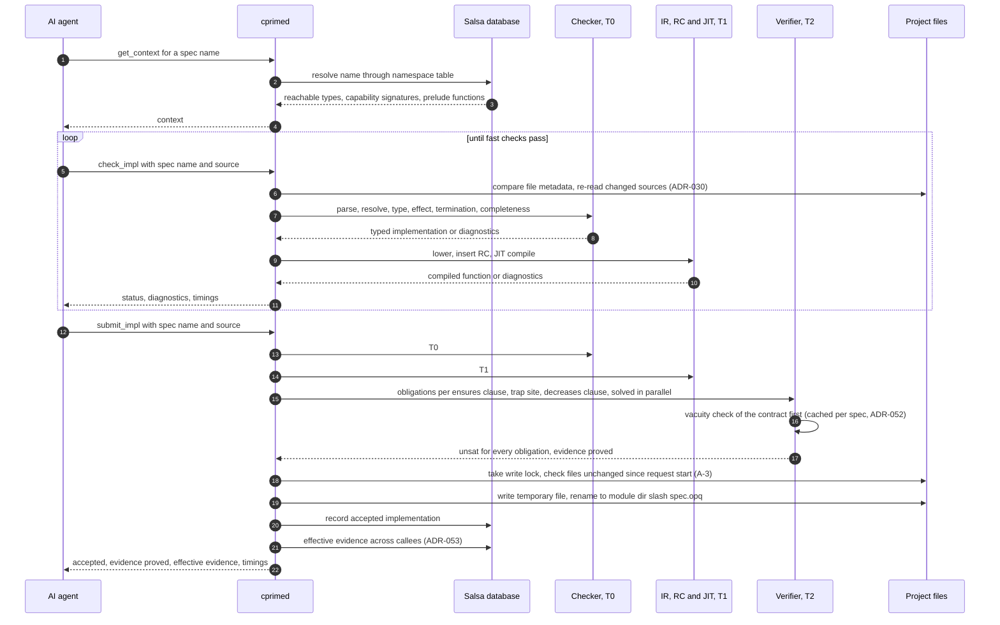
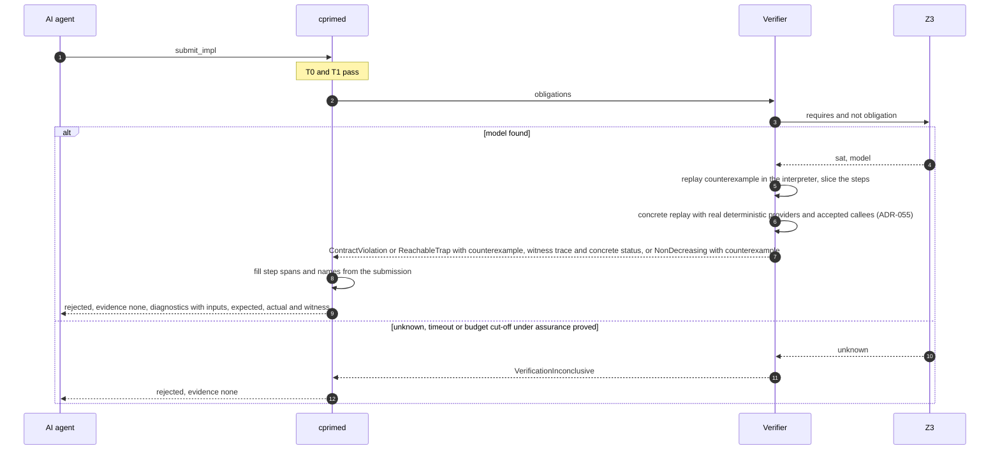
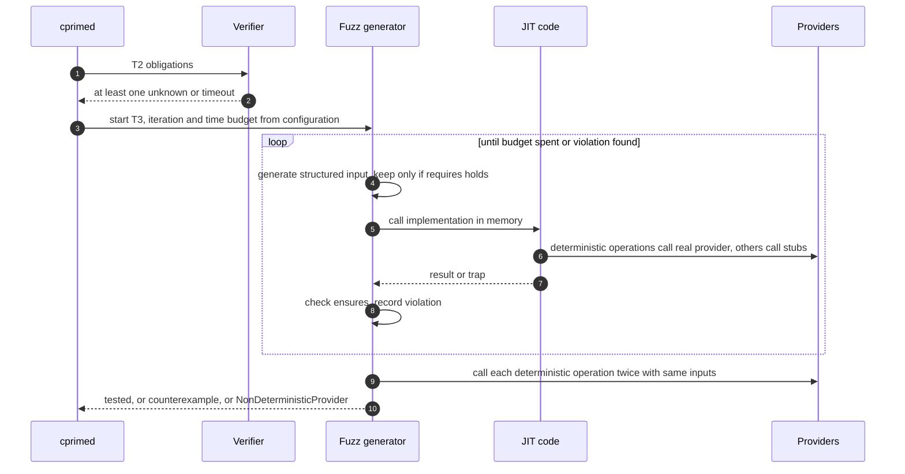
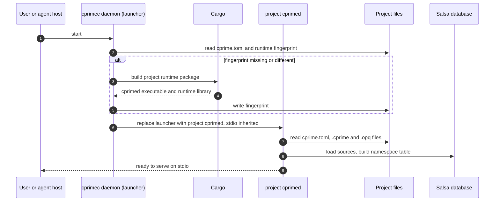
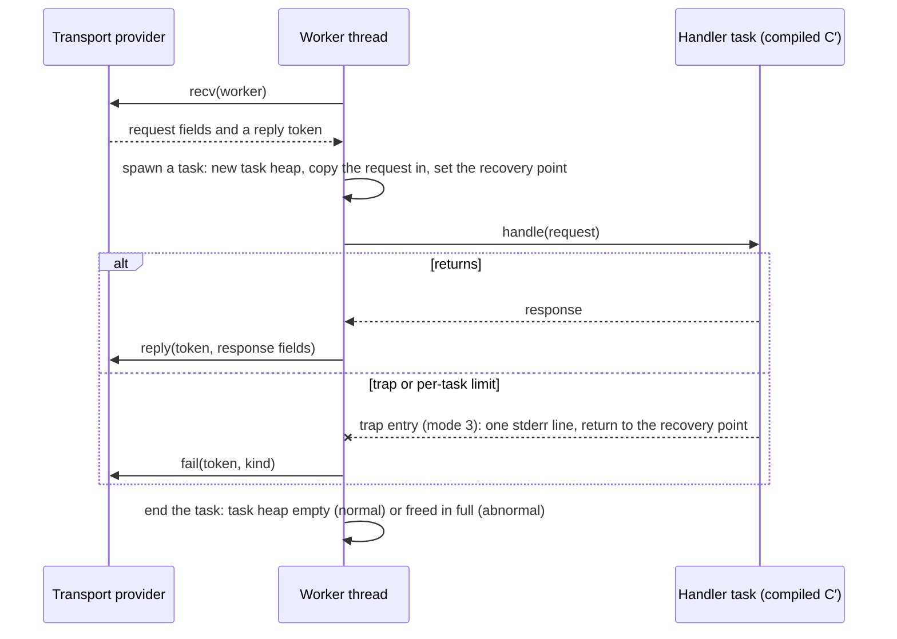
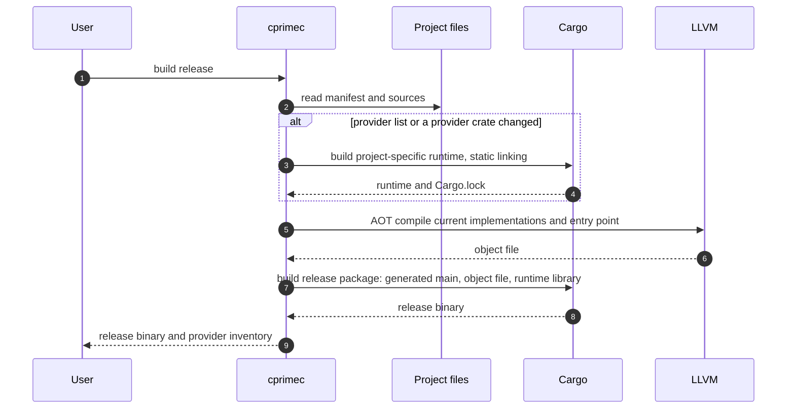

# C′ — Principal Sequences

> **Mode:** draft
> **Generated from:** inline context — `docs/cprime-concept.md` (Draft, revision 2)
> **Revision:** 0.12.0
> **Last updated:** 2025-12-20

## Sequence: implement a spec (golden path)

- **Trigger:** an AI agent is asked to implement a named spec.
- **Result:** the implementation is written to `<module-dir>/<spec>.opq` on disk (e.g. `auth/generate_token.opq`), and the reply reports `accepted` with evidence `proved` and the effective evidence across its callees.
- **Error posture:** any T0/T1 failure returns `status: "rejected"` with diagnostics carrying integer node ids, and nothing is written; the agent revises and retries. A protocol fault (unknown method, malformed parameters, daemon failure) returns a JSON-RPC `error` object instead. A failed atomic write means no acceptance is reported (A-14). If another session changed the files this submission relied on, the write is refused with a conflict and the agent re-reads and resubmits (A-3).

## Sequence: submission rejected with a counterexample

- **Trigger:** `submit_impl` for an implementation that passes T0/T1 but violates its contract, can reach a trap, or cannot be proved within budget.
- **Result:** rejection with a counterexample (inputs, expected, actual) and, for `ContractViolation` and `ReachableTrap`, a witness trace (ADR-047) and a `concrete` or `abstract` classification (ADR-055); or `VacuousContract` when the contract itself admits no input or no result (ADR-052); or `VerificationInconclusive`; nothing is persisted.
- **Error posture:** fail fast, no silent downgrade from `proved` to `tested` (ADR-025). The agent uses the counterexample to correct the implementation.

## Sequence: fuzzing fallback under `assurance tested`

- **Trigger:** T2 returns `unknown`/timeout for at least one obligation and the spec declares `assurance tested`.
- **Result:** evidence `tested` and acceptance if the configured budget (default 10,000 iterations, ≤ 5 s) finds no violation; otherwise a rejection with a counterexample or `NonDeterministicProvider`.
- **Error posture:** fuzzing never performs real I/O; non-deterministic operations are stubbed. When rejection sampling cannot find inputs satisfying `requires` within budget, the result is `VerificationInconclusive` at T3 with `reason: fuzz_budget_incomplete`.

## Sequence: daemon start-up

- **Trigger:** an agent host starts `cprimec daemon` for a project.
- **Result:** the project's `cprimed` serves JSON-RPC and MCP on stdio.
- **Error posture:** a failed Cargo build stops the launch with the build output on stderr and no fingerprint change. Behaviour when an existing `.opq` no longer satisfies its edited spec: stale (ADR-031). A second daemon on the same project starts normally and serves its own client (A-3).

## Sequence: serve a request (ADR-051)

- **Trigger:** the transport has a request ready when a worker asks for one; a busy worker asks for none (back-pressure).
- **Failure:** a trap, `FuelExhausted`, `StackLimit` or `MemoryLimit` inside the handler ends the task, fails that request through the transport, and leaves the worker serving.
- **Shutdown:** on `SIGTERM` or `SIGINT` the transport stops; `recv` returns `Shutdown`; workers finish their task and exit; the process exits 0, or 8 if `limits.shutdown_grace_ms` passes first.

## Sequence: project runtime build and release

- **Trigger:** a user runs `cprimec build --release`.
- **Result:** a native release binary and a provider inventory listing every linked provider crate with its exact `Cargo.lock` version.
- **Error posture:** a failing Cargo build or an invalid `bind` stops the build with a report; no partial binary is emitted (A-15).
