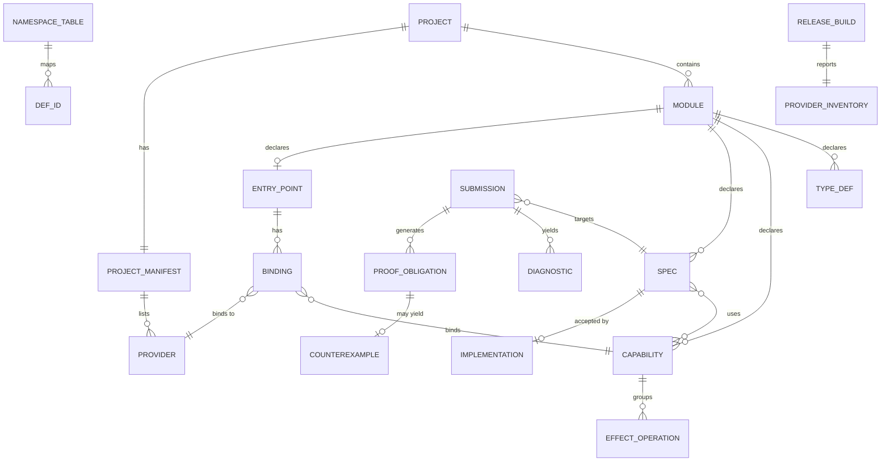

# C′ — Domain Model and Data Lifecycle

> **Mode:** draft
> **Generated from:** inline context — `docs/cprime-concept.md` (Draft, revision 2)
> **Revision:** 0.12.0
> **Last updated:** 2025-12-20

Data types are not fixed here; `/spec` owns them. The C′-IR definitions in the concept (§7) are carried into `/spec` as the starting point for `cprime-core/src/ir.rs`.

## Domain Model

| Entity | Purpose | Key fields | Relationships | Lifecycle |
|---|---|---|---|---|
| Project | The unit `cprimed` serves and `cprimec` builds. | root directory, manifest | has modules, one manifest | Exists while its files exist. |
| Module | Namespace for definitions; one `.cprime` file. | qualified path | declares types, capabilities, specs, optional entry point | Created and edited by the human on disk. |
| Type definition | Struct (record) or sum type, optionally generic. | name, generics, fields or variants | referenced by specs, capabilities, other types | Human-edited; monomorphised per use before IR. |
| Capability | Named set of effect operations. | name, operations | used by specs; bound to providers | Human-edited. |
| Effect operation | One operation of a capability. | name, signature, `deterministic` flag | belongs to a capability; implemented by a provider | Human-edited; must match provider declaration exactly. |
| Spec | Function contract. | name, parameters, return type, `uses`, `assurance`, `unconstrained`, `requires`, `ensures` | uses capabilities; implemented by at most one accepted implementation | Human-edited. Edits after acceptance: OQ-13. |
| Implementation | Agent-written body for a spec. | spec name, positional parameter bindings, body | implements exactly one spec | Candidate (in a request) → accepted (written to disk with an acceptance header) or rejected (discarded). Accepted → stale when its verification context changes (ADR-031). Replaced by a later acceptance. |
| Submission | One `check_impl` or `submit_impl` request. | spec name, source | targets a spec; yields diagnostics, obligations | Transient; never persisted. |
| Diagnostic | Structured finding. | kind, tier, severity, node id, clause, counterexample | belongs to a submission | Transient; returned in the reply. |
| Proof obligation | One verification goal. | kind (`ensures`, trap site, call precondition, `decreases`), result (`unsat`, `sat`, `unknown`, cut off) | generated per submission | Transient; persisting obligations is OQ-26. |
| Counterexample | Inputs violating an obligation. | inputs, expected, actual | from an obligation | Transient. |
| Evidence level | Verification strength reached, relative to the provider operations assumed. | `proved` / `tested` / `none`; assumed provider operations | per submission | Transient; persisted only implicitly by acceptance (A-16). |
| Entry point | Program start. | name, parameters, return type, `uses` | has bindings | Human-edited. |
| Binding | Capability → provider association. | capability path, provider path | joins capability and provider | Human-edited; validated at build. |
| Provider | Rust crate implementing one capability. | crate name, version, operations | listed in manifest; bound by bindings | Added/removed via the manifest; changes trigger a runtime rebuild. |
| Project manifest | Lists provider crates. | provider crates (format in `/spec`) | belongs to project | Human-edited. |
| `DefId` | Content hash of a definition. | 32-byte Blake3 hash | keyed by the namespace table | Recomputed when a definition changes; stable under local renames. |
| Namespace table | Name → `DefId` map. | entries | covers all definitions | Rebuilt from sources on start-up; updated incrementally. |
| Release build | AOT binary. | binary, provider inventory | reports one inventory | Produced by `cprimec`; outside C′ afterwards. |
| Provider inventory | Trusted-code report. | provider crate, exact version | belongs to a release build | Emitted per build. |

## Actions

| Action | Trigger | Inputs | Outputs | Side effects |
|---|---|---|---|---|
| Get context | Agent RPC/MCP call | spec name | reachable definitions | None |
| Check implementation | Agent RPC/MCP call | spec name, source | status, diagnostics, T0/T1 timings | None on disk; Salsa cache updated |
| Submit implementation | Agent RPC/MCP call | spec name, source | status, evidence level, diagnostics, T0–T3 timings | On acceptance: atomic `.opq` write; Salsa cache updated |
| Start daemon | User or agent host | project root | ready state | Reads all project files; loads runtime |
| Build runtime | `cprimec`, when providers change | manifest | project-specific runtime | Cargo build artefacts |
| Release build | User via `cprimec` | sources, manifest | binary, provider inventory | Writes build output |

## Data Lifecycle

- **Origin.** `.cprime` files and the project manifest originate with the human, who writes them or approves an agent's draft (ADR-046); "Human-edited" in the entity table means human-owned in this sense; `.opq` files originate with the agent but reach disk only through `cprimed` acceptance.
- **Storage.** Project files on the local filesystem are authoritative. The Salsa database is an in-memory cache rebuilt on every start-up (A-7). No database, no remote store.
- **Retention.** Accepted implementations persist until replaced by a later acceptance or removed by the user; history lives in the user's version control. Rejected submissions, diagnostics and counterexamples are never persisted.
- **Access.** Anyone with filesystem access to the project, and any local client that can reach `cprimed` (A-1).
- **Sensitive data.** Counterexamples may echo input values chosen by Z3 or the fuzzer; they are synthetic, not user data. A spec's parameters may model secrets (e.g. `secret: Bytes`), but no real secret values pass through `cprimed` during checking. Release binaries may read and write real data through their providers; that is the deploying user's concern.
- **Multi-tenancy.** None.
