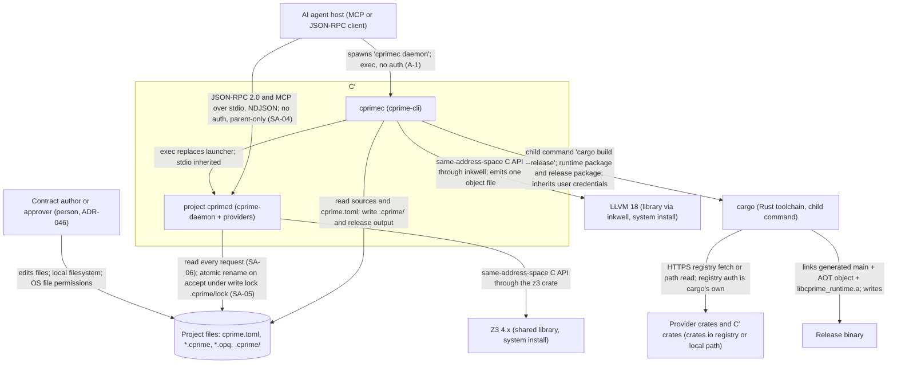

# Phase 2 — Architecture Artefacts

> **Spec set:** cprime
> **Mode:** greenfield
> **derivedFromHld:** 0.12.0
> **HLD-impact status:** adjudicated — see `phase-1-analysis.md` banner.
> **Status:** Approved (RFC 07 amendments promoted by the user on 2025-12-20, after the Phase 6 re-audit)
> **Last updated:** 2025-12-20

## Contents

- [2A System Context Diagram](#2a-system-context-diagram)
- [2B Component Inventory](#2b-component-inventory)
- [2C Shared Types Catalogue](#2c-shared-types-catalogue)
- [2D Configuration](#2d-configuration)
- [2E Cross-Component Interfaces](#2e-cross-component-interfaces)

---

## 2A System Context Diagram



Supported host targets: `x86_64-unknown-linux-gnu`, `aarch64-apple-darwin` (SA-03).

---

## 2B Component Inventory

Workspace layout (paths are repository-relative):

```text
Cargo.toml                      # workspace; [workspace.dependencies] exact pins (SA-02)
rust-toolchain.toml             # SA-01
crates/cprime-provider/           # runtime ABI + provider SDK (no workspace deps)
crates/cprime-core/               # AST, typed AST, IR, IR verifier, hashing, namespace, resolution, Salsa Db, config, context
crates/cprime-syntax/             # .cprime and .opq parsers
crates/cprime-types/              # type checker, monomorphisation, completeness, lowering to IR
crates/cprime-effects/            # effect inclusion, termination structure, binding check
crates/cprime-memory/             # Perceus RC, borrow inference, FBIP
crates/cprime-codegen/            # IR interpreter, Cranelift JIT, LLVM AOT
crates/cprime-verify/             # SMT lowering, obligations, acceptance rules, fuzzing
crates/cprime-daemon/             # JSON-RPC/MCP server library, persistence, source sync
crates/cprime-cli/                # cprimec binary: launcher, runtime build, release build, inventory
providers/cprime-host-crypto/     # host::Crypto
providers/cprime-host-clock/      # host::Clock
providers/cprime-host-random/     # host::Random
providers/cprime-host-log/        # host::Log
```

| # | Component | Type | Phase | Dependencies (workspace) | Complexity | Spec |
|---|---|---|---|---|---|---|
| 1 | `cprime-provider` | Library crate (runtime ABI, SDK) | 2 (ABI), 3 (SDK) | — | M | `components/cprime-provider.md` |
| 2 | `cprime-core` | Library crate | 1 (AST, hashing, namespace, resolution, Db, config, context), 2 (IR, IR verifier) | — | L | `components/cprime-core.md` |
| 3 | `cprime-syntax` | Library crate | 1 | `cprime-core` | L | `components/cprime-syntax.md` |
| 4 | `cprime-types` | Library crate | 1 (checking), 2 (lowering) | `cprime-core` | L | `components/cprime-types.md` |
| 5 | `cprime-effects` | Library crate | 1 | `cprime-core`, `cprime-types` | M | `components/cprime-effects.md` |
| 6 | `cprime-memory` | Library crate | 2 | `cprime-core` | L | `components/cprime-memory.md` |
| 7 | `cprime-codegen` | Library crate | 2 (interpreter), 3 (JIT), 5 (AOT) | `cprime-core`, `cprime-provider` | L | `components/cprime-codegen.md` |
| 8 | Built-in providers | Four library crates | 3 | `cprime-provider` | S | `components/cprime-host-providers.md` |
| 9 | `cprime-verify` | Library crate | 4 (SMT), 5 (fuzzing) | `cprime-core`, `cprime-codegen`, `cprime-provider` | L | `components/cprime-verify.md` |
| 10 | `cprime-daemon` | Library crate (`run`) | 3 (`get_context`, `check_impl`, MCP), 4 (`submit_impl`) | `cprime-core`, `cprime-syntax`, `cprime-types`, `cprime-effects`, `cprime-memory`, `cprime-codegen`, `cprime-verify`, `cprime-provider` | L | `components/cprime-daemon.md` |
| 11 | `cprime-cli` | Binary crate (`cprimec`) | 3 (launcher, runtime build), 5 (release, inventory) | `cprime-core`, `cprime-syntax`, `cprime-types`, `cprime-effects`, `cprime-memory`, `cprime-codegen`, `cprime-provider`, `cprime-daemon` (reuses `CprimeDatabase` and the T0/T1 pipeline) | M | `components/cprime-cli.md` |
| 12 | Project-specific runtime | Generated Cargo package | 3 | `cprime-daemon`, `cprime-provider`, built-in providers, manifest providers | S | Specified inside `components/cprime-cli.md` |

**Build order (valid DAG, topological):** 1 `cprime-provider` → 2 `cprime-core` → 3 `cprime-syntax` → 4 `cprime-types` → 5 `cprime-effects` → 6 `cprime-memory` → 7 `cprime-codegen` → 8 built-in providers → 9 `cprime-verify` → 10 `cprime-daemon` → 11 `cprime-cli` → 12 project runtime (generated at run time by 11). Every dependency edge points to a lower number; there is no cycle.

Dev-dependencies (test only) may point to any lower-numbered crate; `cprime-types` tests use `cprime-syntax` to build inputs.

---

## 2C Shared Types Catalogue

Every type below is used by at least two components. Each consuming spec copies the definitions it uses into its *Shared Context*. All types derive `Debug`; derives listed are additional. Rust paths are the owning crate's public modules.

### Identifiers — `cprime_core::ids`

```rust
/// Interned identifier (names of locals, fields, variants, operations).
#[derive(Clone, Copy, PartialEq, Eq, Hash, PartialOrd, Ord)]
pub struct Symbol(pub u32);

/// Blake3 hash of a definition's canonical serialisation (domain tag "cprime.def.v1\0", SA-28).
#[derive(Clone, Copy, PartialEq, Eq, Hash, PartialOrd, Ord)]
pub struct DefId(pub [u8; 32]);

/// Interned capability. CapId(0) is always the built-in `Diverge`.
#[derive(Clone, Copy, PartialEq, Eq, Hash, PartialOrd, Ord)]
pub struct CapId(pub u32);

/// Pre-order index of a node in the submitted .opq syntax tree; 0 is the `impl` form (SA-32).
#[derive(Clone, Copy, PartialEq, Eq, Hash, PartialOrd, Ord, serde::Serialize)]
#[serde(transparent)]
pub struct NodeId(pub u32);

#[derive(Clone, Copy, PartialEq, Eq, Hash)] pub struct ValueId(pub u32);
#[derive(Clone, Copy, PartialEq, Eq, Hash)] pub struct BlockId(pub u32);
```
Used by: every library crate.

### Untyped AST — `cprime_core::ast`

Produced by `cprime-syntax`; consumed by `cprime-core` (hashing, namespace, resolution, context), `cprime-types`, `cprime-effects` (bindings).

```rust
#[derive(Clone, PartialEq, Eq)] pub struct Ident { pub name: String, pub span: Span }
#[derive(Clone, PartialEq, Eq)] pub struct Path { pub segments: Vec<Ident>, pub span: Span }   // e.g. Auth::CryptoCap::hmac_sha256

// ---------- .cprime ----------
pub struct Module { pub file: String, pub path: Path, pub items: Vec<Item> }
pub enum Item { Type(TypeDef), Capability(CapabilityDef), Spec(SpecDef), Entry(EntryDef), Bind(BindDef), Server(ServerDef) }

pub struct TypeDef { pub name: Ident, pub generics: Vec<Ident>, pub body: TypeDefBody, pub span: Span }
pub enum TypeDefBody { Alias(TypeExpr), Record(Vec<FieldDecl>), Sum(Vec<VariantDecl>) }
pub struct FieldDecl { pub name: Ident, pub ty: TypeExpr }
pub struct VariantDecl { pub name: Ident, pub fields: Vec<FieldDecl>, pub span: Span }
pub struct TypeExpr { pub path: Path, pub args: Vec<TypeArg>, pub span: Span }   // `Unit`, `Vec<U8>`, `FixedBytes<32>`
pub enum TypeArg { Type(TypeExpr), Nat(u32, Span) }

pub struct CapabilityDef { pub name: Ident, pub ops: Vec<CapOpDecl>, pub span: Span }
pub struct CapOpDecl { pub deterministic: bool, pub name: Ident, pub params: Vec<Param>, pub ret: TypeExpr, pub span: Span }
pub struct Param { pub name: Ident, pub ty: TypeExpr }

pub struct SpecDef {
    pub name: Ident, pub params: Vec<Param>, pub ret: TypeExpr,
    pub uses: Vec<Path>,
    pub assurance: Option<(AssuranceLit, Span)>,           // absent = proved
    pub unconstrained: Vec<WaiverItem>,
    pub requires: Vec<ContractExpr>,
    pub ensures: Option<(Ident, Vec<ContractExpr>)>,       // binder name, clauses
    pub span: Span,
}
pub enum AssuranceLit { Proved, Tested }
pub enum WaiverItem { Field(Ident), VariantField(Ident, Ident), VariantTest(Span) }   // `f`, `V.f`, `variant`
pub struct EntryDef { pub name: Ident, pub params: Vec<Param>, pub ret: TypeExpr, pub uses: Vec<Path>, pub span: Span }
pub struct BindDef { pub capability: Path, pub provider: Path, pub span: Span }
pub struct ServerDef { pub name: Ident, pub handler: Path, pub transport: Path, pub span: Span }   // ADR-051; handler: spec path, transport: provider path

pub struct ContractExpr { pub span: Span, pub text: String, pub kind: ContractExprKind }  // text = exact source slice
pub enum ContractExprKind {
    Int(i128), Bool(bool), Bytes(Vec<u8>), Unit,
    Path(Path),                                            // parameter, binder, constant (U64::MAX)
    Call { callee: Path, args: Vec<ContractExpr> },        // prelude function or deterministic capability op
    Field { value: Box<ContractExpr>, name: Ident },       // `e.f`; `e.V.f` parses as two Field nodes, cprime-types decides
    Is { value: Box<ContractExpr>, variant: Ident },
    Unary { op: UnaryOp, operand: Box<ContractExpr> },
    Binary { op: BinaryOp, lhs: Box<ContractExpr>, rhs: Box<ContractExpr> },
}
pub enum UnaryOp { Not, Neg }
pub enum BinaryOp { Implies, Or, And, Eq, Ne, Lt, Le, Gt, Ge, Concat, Add, Sub, Mul, Div, Rem }

// ---------- .opq ----------
pub struct Impl {
    pub file: String,
    pub header: Option<String>,                            // first line, when it starts with ";; cprime-accepted"
    pub spec: Path,
    pub params: Vec<(Ident, NodeId)>,
    pub decreases: Option<Decreases>,
    pub body: Expr,
    pub node_count: u32,
}
pub struct Decreases { pub node: NodeId, pub measure: Vec<Expr> }   // single measure = one element
pub struct Expr { pub node: NodeId, pub span: Span, pub kind: ExprKind }
pub enum ExprKind {
    Int(i128), Bool(bool), Bytes(Vec<u8>), Unit,
    Name(Path),                                            // local, constant, or field-less variant
    Let { bindings: Vec<(Ident, NodeId, Expr)>, body: Box<Expr> },   // sequential
    If { cond: Box<Expr>, then_: Box<Expr>, else_: Box<Expr> },
    Match { scrutinee: Box<Expr>, arms: Vec<Arm> },
    Perform { op: Path, args: Vec<Expr> },
    Apply { head: Path, args: Vec<Expr> },                 // operator, prelude fn, spec call, constructor
    Field { value: Box<Expr>, name: Ident },               // (. e f)
    Vec { items: Vec<Expr> },                              // (vec e…)
    ParMap { spec: Path, xs: Box<Expr> },                    // (par_map S xs), D14
}
pub struct Arm { pub node: NodeId, pub variant: Path, pub binders: Vec<(Ident, NodeId)>, pub body: Expr }
```

### Salsa database and inputs — `cprime_core::db`

Attribute spelling follows the `salsa` version pinned under SA-02; the field set and the trait methods are normative.

```rust
#[salsa::input] pub struct SourceFile { pub path: String, pub text: String }      // path: project-relative, '/'
#[salsa::input] pub struct ProjectInputs {
    pub files: Vec<SourceFile>,             // sorted by path
    pub config: ProjectConfig,
    pub providers: Vec<ProviderInfo>,       // mirror of ProviderRegistry, same order
}

/// Mirror of cprime_provider::BoundaryType (cprime-core cannot depend on cprime-provider).
#[derive(Clone, PartialEq, Eq, Hash)]
pub enum BoundaryTy { Unit, Bool, U8, U64, I64, Bytes, FixedBytes(u32), Vec(Box<BoundaryTy>), Result(Box<BoundaryTy>, Box<BoundaryTy>) }
#[derive(Clone, PartialEq, Eq, Hash)]
pub struct ProviderOpInfo { pub name: String, pub params: Vec<BoundaryTy>, pub ret: BoundaryTy, pub deterministic: bool, pub flat_index: u32,
                           pub vectors: u32 }   // (D40) number of known-answer vectors the operation declares
#[derive(Clone, PartialEq, Eq, Hash)]
pub struct ProviderInfo { pub path: String, pub crate_name: String, pub crate_version: String, pub ops: Vec<ProviderOpInfo>, pub thread_safe: bool, pub transport: Option<TransportInfo> }
#[derive(Clone, PartialEq, Eq, Hash)]
pub struct TransportInfo { pub version: u32, pub request: Vec<(String, BoundaryTy)>, pub response: Vec<(String, BoundaryTy)> }   // ADR-051, SA-66

#[salsa::db]
pub trait Db: salsa::Database {
    fn inputs(&self) -> ProjectInputs;
    fn interner(&self) -> &Interner;                                // Symbol and CapId interning
    // Hooks implemented by cprime_daemon::CprimeDatabase, which links the downstream crates.
    fn parse_module(&self, file: SourceFile) -> Arc<ParsedModule>;
    fn accepted_impl(&self, spec: DefId) -> Option<Arc<AcceptedImpl>>;
    fn impl_status(&self, spec: DefId) -> ImplStatus;
}
pub struct ParsedModule { pub module: Option<ast::Module>, pub diagnostics: Vec<Diagnostic> }
pub struct AcceptedImpl { pub file: String, pub header: AcceptanceHeader, pub timpl: TImpl, pub function: ir::Function }  // function: before RC insertion
```

### Program bundle — `cprime_core::program`

```rust
/// Everything a back end or the verifier needs to compile or run a set of functions.
pub struct Program {
    pub functions: BTreeMap<DefId, ir::Function>,   // after RC insertion when handed to a back end
    pub layouts: Layouts,
    pub schema: TypeSchema,
    pub borrows: BTreeMap<DefId, BorrowSig>,        // one entry per function, and per called spec without an accepted implementation (all owned)
    pub op_targets: BTreeMap<(CapId, Symbol), OpTarget>,
    pub unimplemented: BTreeSet<DefId>,             // called specs with no current implementation; calls link to a trap stub (Unreachable)
}
#[derive(Clone, PartialEq, Eq)] pub struct BorrowSig { pub borrowed: Vec<bool> }   // per parameter; true = callee borrows
#[derive(Clone, Copy, PartialEq, Eq)] pub enum OpTarget { Provider { flat_index: u32 }, Stub }
```
Used by: `cprime-memory` (`BorrowSig`), `cprime-codegen`, `cprime-verify`, `cprime-daemon`, `cprime-cli`.

### C′-IR — `cprime_core::ir`

Concept §7 with the gate-item additions marked `// added`.

```rust
use std::collections::BTreeSet;

#[derive(Clone, PartialEq, Eq, Hash)]
pub enum Type {
    Unit,                                   // added (SA-22)
    Bool, U8, U64, I64,
    Bytes,
    FixedBytes(u32),
    Vec(Box<Type>),
    Struct(DefId),                          // monomorphised struct definition
    Sum(DefId),                             // monomorphised sum definition
    Fn { params: Vec<Type>, ret: Box<Type>, effects: BTreeSet<CapId> },
    Token,                                  // added: DropReuse token; produced only by cprime-memory
}

#[derive(Clone, PartialEq, Eq, Hash)]
pub enum Const { Unit, Bool(bool), U8(u8), U64(u64), I64(i64), Bytes(Vec<u8>) }  // Unit added

#[derive(Clone, Copy, PartialEq, Eq, Hash)]
pub enum BinOp {
    Add, Sub, Mul, Div, Rem,                // checked: trap edge on overflow / division by zero
    WrappingAdd, WrappingSub, WrappingMul,
    Eq, Ne, Lt, Le, Gt, Ge,
    And, Or,                                // strict (both operands already evaluated)
    BytesConcat,
}

#[derive(Clone, Copy, PartialEq, Eq, Hash)]
pub enum IntrinsicOp {                      // added
    U64Be,                                  // (U64) -> Bytes, 8 bytes big-endian
    Push,                                   // (Vec<T>, T) -> Vec<T>
    Slice,                                  // (Bytes, U64, U64) -> Bytes; trap IndexOutOfBounds unless start <= end <= len
    ToBytes,                                // (FixedBytes<N>) -> Bytes
}

#[derive(Clone)]
pub enum Inst {
    Const(Const),
    Bin { op: BinOp, lhs: ValueId, rhs: ValueId },
    Not(ValueId),                                                           // added
    Call { func: DefId, args: Vec<ValueId> },
    Perform { cap: CapId, op: Symbol, args: Vec<ValueId> },
    Intrinsic { op: IntrinsicOp, args: Vec<ValueId> },                      // added
    MakeStruct { ty: DefId, fields: Vec<ValueId>, reuse: Option<ValueId> },
    GetField { value: ValueId, index: u32 },
    MakeVariant { ty: DefId, tag: u32, fields: Vec<ValueId>, reuse: Option<ValueId> },
    GetVariantField { value: ValueId, tag: u32, index: u32 },
    MakeVec { elem: Type, items: Vec<ValueId> },                            // added (constant and computed vectors)
    Len(ValueId),
    Index { vec: ValueId, index: ValueId },                                 // Vec<T>, Bytes, FixedBytes<N>
    ParMap { func: DefId, xs: ValueId },                                     // D14; result type Vec(ret(func))
    RcDup(ValueId),                                                         // cprime-memory only
    RcDrop(ValueId),                                                        // cprime-memory only
    DropReuse(ValueId),                                                     // cprime-memory only; result type Token
}

#[derive(Clone, Copy, PartialEq, Eq, Hash)]
pub enum TrapKind { Overflow, DivisionByZero, IndexOutOfBounds, Unreachable }

#[derive(Clone)]
pub enum Terminator {
    Return(ValueId),
    Jump { target: BlockId, args: Vec<ValueId> },
    Branch { cond: ValueId, then_target: BlockId, then_args: Vec<ValueId>,
             else_target: BlockId, else_args: Vec<ValueId> },
    Switch { scrutinee: ValueId, cases: Vec<(BlockId, Vec<ValueId>)> },  // cases.len() == variant count
    Trap(TrapKind),
}

#[derive(Clone)]
pub struct Block { pub params: Vec<(ValueId, Type)>, pub insts: Vec<(ValueId, Inst)>, pub term: Terminator }

#[derive(Clone)]
pub struct Function {
    pub def: DefId,          // DefId of the spec or entry this function implements
    pub ty: Type,            // always Type::Fn
    pub entry: BlockId,      // entry block params are the function parameters, in order
    pub blocks: Vec<Block>,  // BlockId(i) is blocks[i]
    pub value_count: u32,    // every ValueId in the function is < value_count
    pub node_map: BTreeMap<ValueId, NodeId>,  // (D3, D23) source node of every parameter, non-constant instruction, join parameter and Return value; filled by lowering, preserved by cprime-memory (values it creates have no entry)
}

pub enum IrStage { Lowered, RcInserted }      // (D2)
pub struct IrVerifyError { pub function: DefId, pub block: u32, pub inst: Option<u32>, pub rule: &'static str, pub message: String }

/// Field layouts of every struct and sum reachable from a Function.
pub struct Layouts { pub structs: BTreeMap<DefId, Vec<Type>>, pub sums: BTreeMap<DefId, Vec<Vec<Type>>> }
```
Used by: `cprime-core` (owner, IR verifier), `cprime-types` (lowering), `cprime-memory`, `cprime-codegen`, `cprime-verify`, `cprime-daemon`, `cprime-cli`.

### Typed AST — `cprime_core::tast`

Produced by `cprime-types`; consumed by `cprime-effects`, `cprime-types::lower`, `cprime-verify`.

```rust
pub struct TSpec {
    pub def: DefId,
    pub name: String,                       // fully qualified, e.g. "Auth::generate_token"
    pub params: Vec<(Symbol, Type)>,
    pub ret: Type,
    pub uses: BTreeSet<CapId>,              // includes CapId(0) when Diverge is granted
    pub assurance: Assurance,
    pub waivers: Vec<Waiver>,
    pub requires: Vec<TClause>,
    pub ensures: Vec<TClause>,
    pub is_entry: bool,                     // SA-29
}

pub enum Waiver { Field(Symbol), VariantField { variant: Symbol, field: Symbol }, VariantTest }

pub struct TImpl {
    pub spec: DefId,
    pub params: Vec<(Symbol, NodeId)>,      // positional binders; types come from TSpec
    pub decreases: Option<TDecreases>,
    pub body: TExpr,
    pub node_count: u32,
}

pub struct TDecreases { pub node: NodeId, pub measure: Vec<TExpr> }  // each element has type U64

pub struct TExpr { pub node: NodeId, pub ty: Type, pub kind: TExprKind }

pub enum TExprKind {
    Const(Const),
    Local(u32),                                             // de Bruijn index, 0 = innermost binder
    Let { value: Box<TExpr>, body: Box<TExpr> },            // binds one local
    If { cond: Box<TExpr>, then_: Box<TExpr>, else_: Box<TExpr> },
    Bin { op: BinOp, lhs: Box<TExpr>, rhs: Box<TExpr> },    // op never And/Or here
    Not(Box<TExpr>),
    And(Box<TExpr>, Box<TExpr>),                            // short-circuit
    Or(Box<TExpr>, Box<TExpr>),                             // short-circuit
    Call { func: DefId, args: Vec<TExpr> },
    Perform { cap: CapId, op: Symbol, deterministic: bool, args: Vec<TExpr> },
    Intrinsic { op: IntrinsicOp, args: Vec<TExpr> },
    Len(Box<TExpr>),
    Index { vec: Box<TExpr>, index: Box<TExpr> },
    MakeStruct { ty: DefId, fields: Vec<TExpr> },           // declaration order
    GetField { value: Box<TExpr>, index: u32 },
    MakeVariant { ty: DefId, tag: u32, fields: Vec<TExpr> },
    Match { scrutinee: Box<TExpr>, arms: Vec<TArm> },       // arms[i].tag == i; exhaustive
    MakeVec { elem: Type, items: Vec<TExpr> },
    ParMap { func: DefId, xs: Box<TExpr> },                // D14; type Vec(ret(func))
}

pub struct TArm { pub tag: u32, pub binders: u32, pub body: TExpr }  // binds `binders` locals, field order

/// Contract clause (requires or ensures), typed, with the source text kept for diagnostics.
pub struct TClause { pub text: String, pub span: Span, pub expr: CExpr }

pub struct CExpr { pub ty: Type, pub kind: CExprKind }

pub enum CExprKind {
    Int(i128),                                  // integer literal (mathematical, SA-19)
    Const(Const),                               // non-integer literal
    Param(u32),                                 // spec parameter by position
    Result,                                     // the `ensures` binder `result`
    Bin { op: CBinOp, lhs: Box<CExpr>, rhs: Box<CExpr> },
    Not(Box<CExpr>),
    And(Box<CExpr>, Box<CExpr>), Or(Box<CExpr>, Box<CExpr>), Implies(Box<CExpr>, Box<CExpr>),
    Is { value: Box<CExpr>, tag: u32 },
    Field { value: Box<CExpr>, index: u32 },
    VariantField { value: Box<CExpr>, tag: u32, index: u32 },
    Intrinsic { op: IntrinsicOp, args: Vec<CExpr> },
    Len(Box<CExpr>),
    Index { vec: Box<CExpr>, index: Box<CExpr> },
    OpApp { cap: CapId, op: Symbol, qualified: String, args: Vec<CExpr> },  // deterministic ops only
}
// v1 contracts cannot construct structs or variants and cannot call specs; both are TypeMismatch at T0.

#[derive(Clone, Copy, PartialEq, Eq)]
pub enum CBinOp { Add, Sub, Mul, Div, Rem, Eq, Ne, Lt, Le, Gt, Ge, Concat }
```

### Diagnostics — `cprime_core::diag`

```rust
#[derive(Clone, Copy, PartialEq, Eq, serde::Serialize)]
pub enum DiagnosticKind {
    ParseError, UnknownName, ArityMismatch, TypeMismatch, UnauthorizedEffect,
    MissingDecreases, NonExhaustiveMatch, UnconstrainedOutput, InvalidParMap, // T0
    ContractViolation, ReachableTrap,                                   // T2 / T3
    NonDecreasing, VerificationInconclusive,                            // T2 (VerificationInconclusive also T3, SA-14)
    NonDeterministicProvider,                                           // T3
    InvalidServer,                                                      // T0 (ADR-051)
    VacuousContract, VacuityUnknown,                                    // T2 (D37, ADR-052); VacuityUnknown has severity Note
}

#[derive(Clone, Copy, PartialEq, Eq, serde::Serialize)]
#[serde(rename_all = "lowercase")]
pub enum Tier { T0, T1, T2, T3 }

#[derive(Clone, Copy, PartialEq, Eq, serde::Serialize)]
#[serde(rename_all = "lowercase")]
pub enum Severity { Error, Note }               // SA-32; Note only on VacuityUnknown and never affects acceptance (D37)

#[derive(Clone, PartialEq, Eq, serde::Serialize)]
pub struct Span { pub file: String, pub line: u32, pub column: u32 }
// file: project-relative path with '/' separators, or "<submission>" for the submitted source; line/column 1-based, column in Unicode scalar values.

#[derive(Clone, serde::Serialize)]
pub struct Diagnostic {
    pub kind: DiagnosticKind,
    pub tier: Tier,
    pub severity: Severity,
    pub node: NodeId,
    #[serde(skip_serializing_if = "Option::is_none")] pub span: Option<Span>,
    pub message: String,                                            // one English sentence, no trailing full stop
    #[serde(skip_serializing_if = "Option::is_none")] pub clause: Option<String>,
    #[serde(skip_serializing_if = "Option::is_none")] pub counterexample: Option<Counterexample>,
    #[serde(skip_serializing_if = "Option::is_none")] pub reason: Option<String>,   // VerificationInconclusive only
    #[serde(skip_serializing_if = "Option::is_none")] pub witness: Option<WitnessTrace>,   // (D22) ContractViolation / ReachableTrap with a counterexample only
    #[serde(skip_serializing_if = "Option::is_none")] pub concrete: Option<ConcreteCheck>, // (D43) same diagnostics as witness, set even when witness traces are off
}

/// (D43, ADR-055) Whether a counterexample's violation recurs with real deterministic providers and accepted callees.
#[derive(Clone, serde::Serialize)]
pub struct ConcreteCheck {
    pub status: ConcreteStatus,
    #[serde(skip_serializing_if = "Option::is_none")] pub reason: Option<String>,        // Some iff status is Abstract
    #[serde(skip_serializing_if = "Option::is_none")] pub witness: Option<WitnessTrace>, // the concrete replay's slice; Abstract only, when the replay reached an outcome and verify.witness_max_steps > 0
}

#[derive(Clone, Copy, PartialEq, Eq, serde::Serialize)]
#[serde(rename_all = "lowercase")]
pub enum ConcreteStatus { Concrete, Abstract }

#[derive(Clone)]
pub struct Counterexample {
    pub inputs: Vec<(String, Value)>,       // parameter name → value, in parameter order
    pub expected: Vec<(String, Value)>,
    pub actual: Vec<(String, Value)>,
}
// Serialised as {"inputs": {...}, "expected": {...}, "actual": {...}}; each map keeps vector order.
// For a clause `L == R`: expected = [(text(L), value(R))], actual = [(text(L), value(L))].
// For any other clause: expected = [(clause text, Bool(true))], actual = [(clause text, Bool(false))].
// For a trap: expected = [], actual = [("trap", Value::Str("<TrapKind name>"))], e.g. ("trap", Str("Overflow")).

/// (D22, ADR-047) Witness trace: the executed steps the failing clause or trap depends on.
#[derive(Clone, serde::Serialize)]
pub struct WitnessTrace {
    pub status: WitnessStatus,
    pub steps: Vec<TraceStep>,               // execution order; at most verify.witness_max_steps
    pub omitted: u32,                        // slice steps left out by the bound (the earliest ones)
}

#[derive(Clone, Copy, PartialEq, Eq, serde::Serialize)]
#[serde(rename_all = "snake_case")]
pub enum WitnessStatus { Reproduced, TrapFirst, NotReproduced }

#[derive(Clone, serde::Serialize)]
pub struct TraceStep {
    pub node: NodeId,
    #[serde(skip_serializing_if = "Option::is_none")] pub span: Option<Span>,    // filled by cprime-daemon (D26)
    #[serde(skip_serializing_if = "Option::is_none")] pub name: Option<String>,  // parameter or let binder; filled by cprime-daemon (D26)
    pub kind: StepKind,
    pub value: Value,                        // Branch → Bool; Match → Str(variant name); Trap → Str(TrapKind); otherwise the step's value
    #[serde(skip_serializing_if = "Option::is_none")] pub operands: Option<Vec<Value>>,  // Some only for Compute and Trap, in operand order
    pub source: StepSource,
}

#[derive(Clone, Copy, PartialEq, Eq, serde::Serialize)]
#[serde(rename_all = "snake_case")]
pub enum StepKind { Param, Compute, Construct, Call, Perform, ParMap, Branch, Match, Return, Trap }

#[derive(Clone, Copy, PartialEq, Eq, serde::Serialize)]
#[serde(rename_all = "snake_case")]
pub enum StepSource { Input, Computed, Solver, Generated, Provider }
// Input: a spec parameter; Computed: evaluated by the replay; Solver: taken from the Z3 model (T2);
// Generated: a fuzzing stub's value (T3); Provider: a bound deterministic operation's real result (T3).
```

`reason` values (closed set): `"solver_unknown"`, `"timeout"`, `"budget_cut_off"`, `"fuzz_budget_incomplete"`, `"fuzz_resource_limit"`, `"callee_unimplemented"`, and from RFC 07 `"unsupported_construct"` (D44), `"provider_failure"` (D42), `"provider_timeout"` (D41). `VacuityUnknown` uses `"timeout"`, `"budget_cut_off"` or `"solver_unknown"` (D37). Existing values keep their meaning.

`ConcreteCheck.reason` values (closed set, D43): `"no_violation"` (the concrete run ended without the violation), `"different_outcome"` (it ended with another trap or at another site), `"callee_unimplemented"`, `"stubbed_operation"` (an unbound `deterministic` operation was needed), `"resource_limit"` (fuel, memory or call depth), `"provider_failure"`, `"provider_timeout"`.

Used by: every library crate (producers), `cprime-daemon` (serialiser), `cprime-cli` (renders to stderr).

### Values and Value JSON encoding — `cprime_core::value`

```rust
#[derive(Clone, PartialEq, Eq)]
pub enum Value {
    Unit, Bool(bool), U8(u8), U64(u64), I64(i64),
    Bytes(Vec<u8>), FixedBytes(Vec<u8>),
    Vec(Vec<Value>),
    Struct { fields: Vec<(String, Value)> },                    // declaration order
    Variant { variant: String, fields: Vec<(String, Value)> },
    Str(String),                                                 // diagnostics only (trap kind names); never a C′ value
}

/// Names and types of every struct and sum reachable from a type; built by cprime-types.
pub struct TypeSchema {
    pub structs: BTreeMap<DefId, Vec<(String, Type)>>,                  // field name, field type
    pub sums: BTreeMap<DefId, Vec<(String, Vec<(String, Type)>)>>,      // variant name, fields; index = tag
}

pub fn to_json(v: &Value) -> serde_json::Value;                 // SA-17
pub fn from_json(ty: &Type, schema: &TypeSchema, j: &serde_json::Value) -> Result<Value, ValueDecodeError>;
pub struct ValueDecodeError { pub path: String, pub expected: String }   // path like "$.secret[3]"
```
Encoding (SA-17): `Unit`→`null`; `Bool`→boolean; `U8`/`U64`/`I64`→integer; `Bytes`/`FixedBytes`→`"0x"`+lower-case hex (decoding accepts upper-case, rejects odd length, and for `FixedBytes[N]` rejects length ≠ N); `Vec`→array; struct→object in declaration order (decoding requires exactly the declared keys); variant→`{"<Variant>": {<fields>}}`; `Str`→string.

Used by: `cprime-core` (owner), `cprime-codegen` (release main shim, interpreter results), `cprime-verify` (counterexamples), `cprime-daemon`.

### Evidence and assurance — `cprime_core::evidence`

```rust
#[derive(Clone, Copy, PartialEq, Eq, serde::Serialize)]
#[serde(rename_all = "lowercase")]
pub enum Evidence { Proved, Tested, None }

#[derive(Clone, Copy, PartialEq, Eq)]
pub enum Assurance { Proved, Tested }    // default Proved

/// Outcome of T2/T3 for one submission, produced by cprime-verify.
pub struct VerificationResult {
    pub accepted: bool,
    pub evidence: Evidence,              // Proved or Tested iff accepted
    pub assumed: Vec<String>,            // qualified deterministic operations the result relies on, sorted, deduplicated
    pub diagnostics: Vec<Diagnostic>,    // no Error-severity diagnostic iff accepted; Note diagnostics (D37) may appear either way
    pub t2_us: u64,
    pub t3_us: Option<u64>,              // Some iff T3 ran
    pub witness_us: Option<u64>,         // (D25) Some iff at least one witness or concrete replay ran (D43); reported as timings_us.witness
    pub vacuity: Option<VacuityOutcome>, // (D37) Some iff the vacuity check ran in this call (input.vacuity was None)
}

/// (D37, ADR-052) Outcome of the vacuity check of one spec; Satisfiable and Vacuous are cached by cprime-daemon (D38).
#[derive(Clone)]
pub enum VacuityOutcome { Satisfiable, Vacuous { diagnostic: Diagnostic }, Unknown { reason: &'static str } }

/// (D39, ADR-053) Own and effective evidence of an accepted implementation, computed when reported.
#[derive(Clone, PartialEq, Eq, serde::Serialize)]
pub struct EffectiveEvidence {
    pub own: Evidence,                   // from the implementation's header
    pub effective: Evidence,             // weakest of own and every reachable callee implementation; None if any is not current
    pub tested: Vec<String>,             // reachable callees whose own evidence is Tested, sorted
    pub unaccepted: Vec<UnacceptedCallee>,   // reachable callees that are absent, stale or invalid, sorted by spec
    pub assumed: Vec<String>,            // union of every reachable header's assumed list (own included), sorted, deduplicated
}
#[derive(Clone, PartialEq, Eq, serde::Serialize)]
pub struct UnacceptedCallee { pub spec: String, pub status: String }   // status: "absent" | "stale" | "invalid"
```
Used by: `cprime-verify` (producer), `cprime-daemon`, `cprime-core` (header), `cprime-cli` (`EffectiveEvidence` in `status` and the inventory).

### Acceptance header and implementation status — `cprime_core::accept`

```rust
pub struct AcceptanceHeader {
    pub context: [u8; 32],               // verification context hash
    pub evidence: Evidence,              // Proved or Tested only
    pub assumed: Vec<String>,
}
// Exact line (SA-07), no trailing spaces, terminated by "\n":
// ";; cprime-accepted v1 context=<64 lower-case hex> evidence=<proved|tested> assumed=<a,b,c | ->"
pub fn format_header(h: &AcceptanceHeader) -> String;
pub fn parse_header(first_line: &str) -> Result<AcceptanceHeader, HeaderError>;
pub enum HeaderError { Missing, Malformed { reason: &'static str } }

#[derive(Clone, PartialEq, Eq, serde::Serialize)]
#[serde(tag = "status", rename_all = "lowercase")]
pub enum ImplStatus {
    Absent,                                          // no .opq file
    Current { evidence: Evidence, assumed: Vec<String> },
    Stale,                                           // header context differs from current hash
    Invalid { reason: String },                      // header missing/malformed, or file fails to parse
}
```
Used by: `cprime-core` (owner, context query), `cprime-daemon` (writes headers), `cprime-cli` (release gate).

### Project configuration and manifest — `cprime_core::config`

Parsed from `<root>/cprime.toml` (SA-10), then overridden by `--config key=value` flags.

```rust
#[derive(Clone, serde::Deserialize)]
#[serde(deny_unknown_fields)]
pub struct ProjectConfig {
    pub project: ProjectSection,
    #[serde(default)] pub providers: Vec<ProviderEntry>,
    #[serde(default)] pub limits: Limits,
    #[serde(default)] pub verify: VerifyConfig,
    #[serde(default)] pub fuzz: FuzzConfig,
    #[serde(default)] pub log: LogConfig,
    #[serde(default)] pub runtime: RuntimeConfig,
    #[serde(default)] pub release: ReleaseConfig,   // (D29)
}
pub struct ProjectSection { pub name: String }        // [a-z][a-z0-9_]{0,63}
pub struct ProviderEntry {
    #[serde(rename = "crate")] pub crate_name: String, // Cargo package name
    pub version: Option<String>,                       // exactly one of version / path
    pub path: Option<PathBuf>,                         // relative to project root
    pub provider: String,                              // provider path used in `bind`, e.g. "acme::Zstd"
}
pub struct Limits { pub cpu_time_ms: u64, pub memory_bytes: u64, pub max_call_depth: u64, pub workers: u32, pub request_fuel: u64, pub shutdown_grace_ms: u64 }
pub struct VerifyConfig { pub obligation_timeout_ms: u64, pub submission_budget_ms: u64, pub solver_threads: Option<u32>, pub witness_max_steps: u32,
                         pub provider_wait_ms: u64 }   // (D41) 10 … 600,000, default 2000
pub struct FuzzConfig { pub iterations: u64, pub time_budget_ms: u64, pub call_fuel: u64, pub call_memory_bytes: u64, pub seed: Option<u64> }
pub struct LogConfig { pub level: LogLevel }
#[derive(Clone, Copy, serde::Deserialize)] #[serde(rename_all = "lowercase")]
pub enum LogLevel { Error, Warn, Info, Debug, Trace }
pub struct RuntimeConfig { pub cprime_source: Option<PathBuf> }   // path to a C′ source checkout; None = crates.io at cprimec's version
pub struct ReleaseConfig { pub call_chain: bool }               // (D28, D29) release binaries record and report the spec call chain

pub fn load_config(root: &Path, overrides: &[(String, String)]) -> Result<ProjectConfig, ConfigError>;
pub enum ConfigError {
    NotFound { root: PathBuf },
    Io { path: PathBuf, message: String },
    Toml { line: u32, column: u32, message: String },
    Invalid { key: String, message: String },          // range, format or exclusivity violation
    UnknownOverride { key: String },
}
```
Defaults and ranges: §2D. Example `cprime.toml`:

```toml
[project]
name = "auth_service"

[[providers]]
crate = "cprime-zstd-provider"
version = "0.3.1"
provider = "acme::Zstd"

[verify]
submission_budget_ms = 4000
```
Used by: `cprime-core` (owner), `cprime-daemon`, `cprime-cli`, `cprime-verify` (reads `verify`, `fuzz`), `cprime-codegen` (reads `limits`).

### Provider SDK and runtime ABI — `cprime_provider`

```rust
/// Types allowed at the provider boundary (SA-22 adds Unit).
#[derive(Clone, PartialEq, Eq)]
pub enum BoundaryType { Unit, Bool, U8, U64, I64, Bytes, FixedBytes(u32), Vec(Box<BoundaryType>), Result(Box<BoundaryType>, Box<BoundaryType>) }

/// Uniform C ABI of every provider operation: arguments are 64-bit words (SA-25), result is one word.
pub type OpFn = unsafe extern "C" fn(args: *const u64, rt: *mut RtContext) -> u64;

#[derive(Clone)]
pub struct OpDecl {
    pub name: &'static str,                      // operation name, e.g. "hmac_sha256"
    pub params: Vec<BoundaryType>,
    pub ret: BoundaryType,
    pub deterministic: bool,                     // (D40, ADR-054) equal results for equal arguments, no observable effect, returns without waiting on anything outside the call
    pub func: OpFn,
    pub vectors: &'static [KnownAnswer],         // (D40) known-answer vectors; empty allowed; must be empty when a param or ret is Vec or Result
}
/// (D40) One known-answer vector: arguments in parameter order and the expected result.
#[derive(Clone, Copy)]
pub struct KnownAnswer { pub args: &'static [Lit], pub ret: Lit }
/// (D40) A literal boundary value; Bytes also encodes FixedBytes[N] (length must equal N).
#[derive(Clone, Copy, PartialEq, Eq)]
pub enum Lit { Unit, Bool(bool), U8(u8), U64(u64), I64(i64), Bytes(&'static [u8]) }
#[derive(Clone)]
pub struct ProviderDecl { pub path: &'static str, pub crate_name: &'static str, pub crate_version: &'static str, pub ops: Vec<OpDecl>, pub thread_safe: bool, pub transport: Option<TransportDecl> }

/// (D30, ADR-051, SA-66) Transport interface. A request or response is a flat record of boundary values, passed as one word per field in declaration order.
#[repr(u32)] #[derive(Clone, Copy, PartialEq, Eq)]
pub enum RecvStatus { Request = 0, Shutdown = 1, Error = 2, Pending = 3 /* reserved; v1 runtimes treat it as Error */ }
pub type TransportStartFn = unsafe extern "C" fn(config: *const u8, config_len: usize, err: *mut u8, err_cap: usize) -> u32;   // 0 = started; else err holds a UTF-8 reason
pub type TransportRecvFn  = unsafe extern "C" fn(worker: u32, fields: *mut u64, token: *mut u64, rt: *mut RtContext) -> RecvStatus; // fields: one word per request field, allocated in rt's task heap
pub type TransportReplyFn = unsafe extern "C" fn(token: u64, fields: *const u64, rt: *mut RtContext);                               // response fields, read before the task heap is freed
pub type TransportFailFn  = unsafe extern "C" fn(token: u64, trap: u32);                                                               // RtTrap code of the failed task
pub type TransportStopFn  = unsafe extern "C" fn();                                                                                     // async-signal-safe: sets a flag only
#[derive(Clone)]
pub struct TransportDecl {
    pub version: u32,                                   // 1 in v1
    pub request: Vec<(&'static str, BoundaryType)>,
    pub response: Vec<(&'static str, BoundaryType)>,
    pub start: TransportStartFn, pub recv: TransportRecvFn, pub reply: TransportReplyFn, pub fail: TransportFailFn, pub stop: TransportStopFn,
}

/// Every provider crate exposes this function at its crate root (D8); the generated runtime calls it.
/// pub fn cprime_provider() -> cprime_provider::ProviderDecl

/// Every provider a runtime links. Order: built-ins (Crypto, Clock, Random, Log), then cprime.toml order.
#[derive(Clone)]
pub struct ProviderRegistry { pub providers: Vec<ProviderDecl> }
impl ProviderRegistry {
    /// Global operation index: providers in order, operations in declaration order within each.
    /// AOT code calls operation k as an indirect call through entry k of the table that
    /// `cprime_rt_op_table` points to (D7). The JIT calls through its own operation table (§2E).
    pub fn flat_ops(&self) -> Vec<(&ProviderDecl, &OpDecl)>;
    /// JSON description printed by `cprimed --describe-providers` (consumed by cprimec; stored as .cprime/providers.json).
    pub fn describe_json(&self) -> serde_json::Value;
}

/// Exported by the generated runtime library (D7): a pointer to a heap array of OpFn in flat_ops() order,
/// stored once by the generated `init_op_table()` before the entry function runs.
/// #[no_mangle] pub static cprime_rt_op_table: AtomicPtr<OpFn>

#[repr(C)]
pub struct RtContext {      // field order is ABI: JIT and AOT code address fields by offset
    pub trap: u32,          // offset 0:  RtTrap code; 0 = none
    pub mode: u32,          // offset 4:  0 = abort on trap (release), 1 = record and return (interpreter, JIT), 2 = worker (park on trap; par_map), 3 = server task (unwind to the task's recovery point on trap; ADR-051)
    pub fuel: u64,          // offset 8:  remaining function entries; u64::MAX = unlimited
    pub depth: u64,         // offset 16: current C′ call depth (D6)
    pub max_depth: u64,     // offset 24: call depth at which a call traps StackLimit (D6)
    pub mem_limit: u64,     // offset 32: bytes
    pub mem_live: u64,      // offset 40: bytes currently allocated through this context
    pub tracker: *mut AllocTracker,   // offset 48: non-null in leak-harness and fuzz runs
    pub site: u64,          // offset 56: (D27) site id of the Perform in progress (AOT only); 0 = none
    pub chain: *mut u32,    // offset 64: (D28) call-chain buffer indexed by depth; null = no call chain
}

#[repr(u32)] #[derive(Clone, Copy, PartialEq, Eq)]
pub enum RtTrap { None = 0, Overflow = 1, DivisionByZero = 2, IndexOutOfBounds = 3, Unreachable = 4,
                  FuelExhausted = 5, MemoryLimit = 6, ProviderPanic = 7, StackLimit = 8 }

/// (D27) Trap entry with a release trap site; mode 1 behaves as cprime_rt_trap.
/// #[no_mangle] pub unsafe extern "C" fn cprime_rt_trap_at(rt: *mut RtContext, code: u32, site: u32)

/// (D27) One row of the trap site table or the function table generated into a release binary.
pub struct SiteEntry {
    pub spec: &'static str,     // qualified spec name
    pub file: &'static str,     // project-relative .opq path
    pub line: u32,              // 1-based
    pub column: u32,            // 1-based, Unicode scalar values
    pub op: &'static str,       // "<Cap>::<op>" for Perform sites; empty otherwise
}
/// (D27) Registers the tables once, before cprime_rt_release_init; a second call is ignored and returns false.
/// pub fn rt::set_report_tables(sites: &'static [SiteEntry], functions: &'static [SiteEntry]) -> bool
```

Call depth (D6): every function entry increments `rt.depth` and every return decrements it; an entry that would make `depth > max_depth` traps `StackLimit`. Native frames of JIT and AOT code are at most 1 KiB each, so code runs on a thread whose stack is at least `max_depth × 1 KiB + 1 MiB`: the release `main` spawns such a thread for the entry call; `cprime-verify` runs fuzzed calls on a thread with a 64 MiB stack and `max_depth = 50000`. The interpreter uses an explicit frame stack and enforces the same limit.

Heap object layout (all heap values; little-endian words; 8-byte aligned):

| Offset | Size | Field |
|---|---|---|
| 0 | 8 | `rc: u64` — non-atomic count, 1 on allocation |
| 8 | 4 | `len: u32` — byte count (`Bytes`, `FixedBytes`), element count (`Vec`), field count (struct, variant) |
| 12 | 2 | `tag: u16` — variant tag for sums; 0 otherwise |
| 14 | 1 | `kind: u8` — 0 = byte payload (`Bytes`, `FixedBytes`), 1 = `Vec`, 2 = struct, 3 = variant |
| 15 | 1 | reserved, 0 |
| 16 | 8 | `ptr_mask: u64` — bit *i* set when word *i* of the payload is a heap pointer (struct and variant fields; for `Vec`, bit 0 set means every element is a pointer); 0 for byte payloads |
| 24 | … | payload: bytes, or 8-byte words |

Limits that follow from the layout: at most 64 fields per struct or variant, at most 65,536 variants per sum type, at most 2^32 − 1 bytes or elements per value. `cprime-types` reports a breach of the first two as `TypeMismatch`; the runtime traps `MemoryLimit` on the third.

Runtime support functions exported by `cprime-provider` with `#[no_mangle] extern "C"` and called by JIT and AOT code: `cprime_rt_alloc(rt, payload_bytes, len, tag, kind, ptr_mask) -> u64`, `cprime_rt_dup(ptr)`, `cprime_rt_drop(rt, ptr)`, `cprime_rt_drop_reuse(rt, ptr) -> u64` (token), `cprime_rt_eq(a, b) -> u64`, `cprime_rt_concat(rt, a, b) -> u64`, `cprime_rt_u64_be(rt, x) -> u64`, `cprime_rt_push(rt, v, x) -> u64`, `cprime_rt_slice(rt, b, start, end) -> u64`, `cprime_rt_to_bytes(rt, b) -> u64`, `cprime_rt_trap(rt, code)`, `cprime_rt_par_map(rt, f, owns_arg, ret_is_ptr, xs) -> u64` (D19), and for release binaries `cprime_rt_release_init(rt, cpu_time_ms, memory_bytes, max_call_depth, workers) -> u32` (0 = ok, 1 = CPU limit could not be set; D20). Exact semantics: `components/cprime-provider.md`.

Release exit codes — `ExitCode` (SA-16):

| Code | Meaning |
|---|---|
| 0 | Entry returned; result written to stdout |
| 2 | Standard input is not one JSON object matching the entry parameters |
| 3 | Trap (`Overflow`, `DivisionByZero`, `IndexOutOfBounds`, `Unreachable`); one stderr line `cprime: trap <Kind>` |
| 4 | CPU-time limit exceeded, or the limit could not be set at start (`cprime: cannot set cpu time limit`) |
| 5 | Memory limit exceeded |
| 6 | Provider panic |
| 7 | Call-depth limit exceeded (`StackLimit`) |
| 8 | Server only (ADR-051): the shutdown grace period expired with a request still running; stderr `cprime: shutdown grace period expired with <n> request(s) running` |
| 9 | Server only (ADR-051): the transport failed to start; stderr `cprime: transport <path> failed to start: <reason>` (reason truncated to 200 characters) |

Used by: `cprime-provider` (owner), `cprime-codegen`, `cprime-verify`, built-in providers, `cprime-daemon`, `cprime-cli`.

### Prelude — `cprime_core::prelude`

| Member | C′ signature | Notes |
|---|---|---|
| `Hash` | `type Hash = FixedBytes[32]` | alias |
| `Result` | `enum Result[T, E] { Ok { value T }; Err { error E } }` | tags: `Ok`=0, `Err`=1 |
| `Option` | `enum Option[T] { Some { value T }; None }` | tags: `Some`=0, `None`=1 |
| `len` | `(Bytes) U64`, `(FixedBytes[N]) U64`, `(Vec[T]) U64` | `Inst::Len` |
| `index` | `(Vec[T], U64) T`, `(Bytes, U64) U8`, `(FixedBytes[N], U64) U8` | traps `IndexOutOfBounds` |
| `++` | `(Bytes, Bytes) Bytes` | `BinOp::BytesConcat` |
| `u64_be` | `(U64) Bytes` | 8 bytes |
| `push` | `(Vec[T], T) Vec[T]` | |
| `slice` | `(Bytes, U64, U64) Bytes` | traps unless `start <= end <= len` |
| `to_bytes` | `(FixedBytes[N]) Bytes` | |
| `U8::MAX`, `U64::MAX`, `I64::MIN`, `I64::MAX` | constants | |
| `Diverge` | built-in capability, no operations | `CapId(0)` |

### Built-in provider operations (SA-35)

| Provider | Operation | C′ signature | `deterministic` |
|---|---|---|---|
| `host::Crypto` | `sha256` | `(msg Bytes) FixedBytes[32]` | yes |
| `host::Crypto` | `hmac_sha256` | `(key Bytes, msg Bytes) FixedBytes[32]` | yes |
| `host::Crypto` | `blake3` | `(msg Bytes) FixedBytes[32]` | yes |
| `host::Clock` | `now_unix_seconds` | `() U64` | no |
| `host::Clock` | `monotonic_nanos` | `() U64` | no |
| `host::Random` | `random_bytes` | `(n U64) Bytes` | no |
| `host::Random` | `random_u64` | `() U64` | no |
| `host::Log` | `info` | `(msg Bytes)` | no |
| `host::Log` | `warn` | `(msg Bytes)` | no |
| `host::Log` | `error` | `(msg Bytes)` | no |

---

## 2D Configuration

Configuration is read once at start (A-10) from `<root>/cprime.toml`, then overridden by repeated `--config <key>=<value>` flags. No environment variable is read. Invalid values stop start-up with `ConfigError` (exit code 2 for `cprimec`, see `components/cprime-cli.md`; `cprimed` writes a JSON-RPC-free stderr error and exits 2).

| Key | Type | Default | Required | Owner component | Description |
|---|---|---|---|---|---|
| `project.name` | string `[a-z][a-z0-9_]{0,63}` | — | yes | `cprime-core` | Project name; release binary file name |
| `providers[].crate` | string | — | yes, per entry | `cprime-cli` | Cargo package name of a provider |
| `providers[].version` | string (Cargo version requirement written as exact version) | — | exactly one of `version`/`path` | `cprime-cli` | Registry version, pinned with `=` in the generated runtime |
| `providers[].path` | path, relative to root | — | exactly one of `version`/`path` | `cprime-cli` | Local provider crate |
| `providers[].provider` | string, `Ident(::Ident)*` | — | yes, per entry | `cprime-cli`, `cprime-effects` | Provider path used in `bind`; unique across built-ins and entries |
| `limits.cpu_time_ms` | u64, 1 … 86,400,000 | 10000 | no | `cprime-codegen` | Release binary CPU-time limit for batch entries only (server binaries set none, ADR-051) (`RLIMIT_CPU`, rounded up to whole seconds) |
| `limits.memory_bytes` | u64, 1,048,576 … 2^40 | 1073741824 | no | `cprime-provider` | Release binary live-heap limit |
| `limits.max_call_depth` | u64, 1,000 … 10,000,000 | 100000 | no | `cprime-codegen`, `cprime-cli` | Release binary call-depth limit (D6); the entry thread's stack is `max_call_depth × 1 KiB + 1 MiB` |
| `limits.workers` | u32, 0 … 256 | 0 | no | `cprime-cli`, `cprime-provider` | Release binary `par_map` worker count and server worker-thread count (ADR-051); 0 = available parallelism, capped at 256 (D20) |
| `limits.request_fuel` | u64, 1 … 2^63 | 100000000 | no | `cprime-cli`, `cprime-provider` | Server only (ADR-051): function entries one server task may make before it fails with `FuelExhausted` |
| `limits.shutdown_grace_ms` | u64, 0 … 600,000 | 10000 | no | `cprime-cli`, `cprime-provider` | Server only: time running tasks get to finish after `SIGTERM`/`SIGINT` before exit 8 |
| `verify.obligation_timeout_ms` | u64, 1 … 600,000 | 250 | no | `cprime-verify` | Z3 timeout per obligation |
| `verify.submission_budget_ms` | u64, 1 … 3,600,000; ≥ `obligation_timeout_ms` | 2000 | no | `cprime-verify` | Wall-clock T2 budget per submission |
| `verify.solver_threads` | u32, 1 … 64 | min(4, available parallelism) | no | `cprime-verify` | Parallel Z3 contexts |
| `fuzz.iterations` | u64, 1 … 10,000,000 | 10000 | no | `cprime-verify` | `requires`-satisfying executions T3 must complete |
| `fuzz.time_budget_ms` | u64, 1 … 3,600,000 | 5000 | no | `cprime-verify` | Wall-clock T3 budget |
| `fuzz.call_fuel` | u64, 1,000 … 2^63 | 10000000 | no | `cprime-verify` | Fuel per fuzzed call |
| `fuzz.call_memory_bytes` | u64, 65,536 … 2^40 | 67108864 | no | `cprime-verify` | Live-heap limit per fuzzed call |
| `fuzz.seed` | u64 | first 8 bytes (little-endian) of the implementation `DefId` | no | `cprime-verify` | Generator seed; the default makes T3 reproducible per implementation |
| `verify.witness_max_steps` | u32, 0 … 1024 | 64 | no | `cprime-verify` | Maximum steps per witness trace; 0 = no witness traces (D25) |
| `verify.provider_wait_ms` | u64, 10 … 600,000 | 2000 | no | `cprime-verify` | How long checking waits for a thread inside provider code beyond its deadline before abandoning it (D41, ADR-054) |
| `release.call_chain` | bool | `false` | no | `cprime-cli`, `cprime-codegen` | Release binaries record and report the spec call chain on exits 3–7 (D28) |
| `log.level` | `error` \| `warn` \| `info` \| `debug` \| `trace` | `info` | no | cross-cutting Logging | Minimum level written to stderr |
| `runtime.cprime_source` | path | none (crates.io at `cprimec`'s own version) | no | `cprime-cli` | C′ source checkout used as path dependencies in the generated runtime |

Command-line flags that are not configuration keys (`--project`, `--config`, `--release`, `--out`) are specified in `components/cprime-cli.md` and `components/cprime-daemon.md`.

---

## 2E Cross-Component Interfaces

The public functions each crate offers to the others. Every consuming spec copies the signatures it calls; every providing spec documents them in *Public Interface*. A signature change here is a change to both sides.

### Additional shared type — `cprime_core::tast` (termination)

```rust
/// Produced by cprime-effects; consumed by cprime-verify and cprime-daemon.
pub struct TerminationInfo {
    pub component: BTreeSet<DefId>,         // recursive component containing the candidate; empty if not recursive
    pub diverges: bool,                      // candidate's uses contains Diverge: no decreases obligations
    pub edges: Vec<CallEdge>,                // every call edge inside the component
    pub diagnostics: Vec<Diagnostic>,        // MissingDecreases, TypeMismatch (measure length)
}
pub struct CallEdge { pub caller: DefId, pub callee: DefId, pub node: NodeId, pub caller_is_candidate: bool }
```

### Interface table

| Provider crate | Function | Called by |
|---|---|---|
| `cprime-syntax` | `parse_cprime(file: &str, text: &str) -> ParsedModule` | `cprime-daemon` (`Db::parse_module` hook), `cprime-cli` |
| `cprime-syntax` | `parse_opq(file: &str, text: &str) -> (Option<ast::Impl>, Vec<Diagnostic>)` | `cprime-daemon` (`cprime-cli` through `pipeline::front_end` and the `Db` hooks) |
| `cprime-core` | `namespace::namespace_table(db: &dyn Db) -> Arc<NamespaceTable>` | `cprime-types`, `cprime-effects`, `cprime-daemon`, `cprime-cli` |
| `cprime-core` | `resolve::lookup(db: &dyn Db, scope: &Scope, path: &ast::Path) -> Result<Res, Diagnostic>` | `cprime-types`, `cprime-effects` |
| `cprime-core` | `context::get_context(db: &dyn Db, spec_name: &str) -> Result<ContextResult, ContextError>` | `cprime-daemon` |
| `cprime-core` | `accept::context_hash(db: &dyn Db, spec: DefId, deps: &BTreeSet<DefId>) -> [u8; 32]` | `cprime-daemon` (`cprime-cli` through `Db::impl_status`) |
| `cprime-core` | `accept::format_header`, `accept::parse_header` | `cprime-daemon`, `cprime-cli` |
| `cprime-core` | `ir_verify::verify_function(f: &ir::Function, layouts: &Layouts, stage: IrStage) -> Result<(), IrVerifyError>` | `cprime-memory` (after each pass), `cprime-daemon` and `cprime-cli` (after `lower`), `cprime-types` tests |
| `cprime-core` | `namespace::namespace_diagnostics(db: &dyn Db) -> Arc<Vec<Diagnostic>>` | `cprime-daemon`, `cprime-cli` |
| `cprime-core` | `hash::impl_def_id(db: &dyn Db, imp: &ast::Impl) -> Result<DefId, Diagnostic>` (D10) | `cprime-daemon`, `cprime-cli` |
| `cprime-core` | `paths::snake_case(segment: &str) -> String` (D1) | `cprime-syntax`, `cprime-core::paths` |
| `cprime-core` | (D26) `ast::node_index(imp: &ast::Impl) -> NodeIndex`; `NodeIndex { spans: Vec<Span>, names: BTreeMap<NodeId, String> }` | `cprime-daemon` (witness spans and names), `cprime-cli` (release site tables) |
| `cprime-core` | `paths::module_file(module: &str) -> String`, `paths::impl_file(spec_qualified: &str) -> String` | `cprime-daemon`, `cprime-cli`, `cprime-core::context` |
| `cprime-core` | `config::load_config(root: &Path, overrides: &[(String, String)]) -> Result<ProjectConfig, ConfigError>` | `cprime-daemon`, `cprime-cli` |
| `cprime-core` | `value::to_json`, `value::from_json` | `cprime-core` (`Counterexample` serialisation used by `cprime-daemon` replies), `cprime-codegen`, `cprime-cli` (release input decoding rules) |
| `cprime-types` | `check_spec(db: &dyn Db, def: DefId) -> Arc<SpecCheck>`; `SpecCheck { spec: TSpec, schema: TypeSchema, diagnostics: Vec<Diagnostic> }` | `cprime-effects`, `cprime-daemon`, `cprime-cli` |
| `cprime-types` | `check_impl(db: &dyn Db, spec: &TSpec, imp: &ast::Impl) -> ImplCheck`; `ImplCheck { timpl: Option<TImpl>, diagnostics: Vec<Diagnostic> }` | `cprime-daemon`, `cprime-cli` |
| `cprime-types` | `capability_ops(db: &dyn Db, cap: CapId) -> Arc<Vec<CapOpSig>>`; `CapOpSig { name: Symbol, params: Vec<Type>, ret: Type, deterministic: bool }` | `cprime-effects`, `cprime-verify` (via `VerifyInput`), `cprime-daemon` |
| `cprime-types` | `lower(db: &dyn Db, spec: &TSpec, imp: &TImpl) -> (ir::Function, Layouts)` | `cprime-daemon`, `cprime-cli` |
| `cprime-types` | `verification_deps(db: &dyn Db, spec: &TSpec, imp: &TImpl) -> BTreeSet<DefId>` | `cprime-daemon`, `cprime-cli` |
| `cprime-types` | `mono_instance_id(generic: DefId, args: &[Type]) -> DefId` | `cprime-effects` |
| `cprime-effects` | `check_effects(db: &dyn Db, spec: &TSpec, imp: &TImpl) -> Vec<Diagnostic>` | `cprime-daemon`, `cprime-cli` |
| `cprime-effects` | `termination(db: &dyn Db, spec: &TSpec, imp: &TImpl) -> TerminationInfo` | `cprime-daemon`, `cprime-cli` |
| `cprime-effects` | `check_bindings(db: &dyn Db) -> Arc<BindingCheck>`; `BindingCheck { bindings: BTreeMap<CapId, u32 /* index into ProjectInputs.providers */>, diagnostics: Vec<Diagnostic> }` | `cprime-daemon`, `cprime-cli` |
| `cprime-memory` | `infer_borrows(functions: &BTreeMap<DefId, ir::Function>, fixed: &BTreeMap<DefId, BorrowSig>) -> BTreeMap<DefId, BorrowSig>` | `cprime-daemon`, `cprime-cli` |
| `cprime-memory` | `insert_rc(f: &ir::Function, layouts: &Layouts, borrows: &BTreeMap<DefId, BorrowSig>) -> Result<ir::Function, IrVerifyError>` | `cprime-daemon`, `cprime-cli` |
| `cprime-memory` | (D45) `insert_rc_opts(f: &ir::Function, layouts: &Layouts, borrows: &BTreeMap<DefId, BorrowSig>, opts: RcOptions) -> Result<ir::Function, IrVerifyError>`; `RcOptions { pub reuse: bool }` | `cprime-codegen` tests (Part 6 item 29) |
| `cprime-codegen` | `interp::run(program: &Program, func: DefId, args: &[Value], rt: &mut RtContext, registry: &ProviderRegistry) -> Result<Value, RtTrap>` | tests, `cprime-verify` (differential checks only) |
| `cprime-codegen` | (D24) `interp::replay(program: &Program, func: DefId, args: &[Value], rt: &mut RtContext, registry: &ProviderRegistry, oracle: &mut dyn ReplayOracle) -> Replay` | `cprime-verify` (witness traces), tests (differential trap location) |
| `cprime-codegen` | `jit::JitModule::compile(program: &Program, registry: &ProviderRegistry) -> Result<JitModule, CodegenError>` | `cprime-daemon` |
| `cprime-codegen` | `unsafe jit::JitModule::call(&self, func: DefId, args: &[u64], rt: &mut RtContext) -> u64` | `cprime-verify` |
| `cprime-codegen` | (D4) `jit::JitModule::ops(&self) -> Vec<(CapId, Symbol, OpTarget)>`; `jit::JitModule::set_op(&self, cap: CapId, op: Symbol, f: StubFn, op_id: u32) -> Result<(), CodegenError>`; `jit::JitModule::reset_ops(&self)` (interior-mutable slots; `VerifyInput::jit` is a shared reference); `pub type StubFn = unsafe extern "C" fn(op_id: u32, args: *const u64, rt: *mut RtContext) -> u64` | `cprime-verify` |
| `cprime-codegen` | `marshal::value_to_word(v: &Value, ty: &Type, program: &Program, rt: &mut RtContext) -> u64`; `marshal::word_to_value(w: u64, ty: &Type, program: &Program) -> Value` | `cprime-verify` |
| `cprime-codegen` | (D28) `aot::emit_object(program: &Program, entry: DefId, out: &Path, opts: &AotOptions) -> Result<AotOutput, CodegenError>` | `cprime-cli` |
| `cprime-verify` | `verify(input: VerifyInput) -> VerificationResult`; (D5, D41) `try_verify(input: VerifyInput) -> Result<VerificationResult, VerifyError>` (the input is taken by value because it owns the `JitModule`) | `cprime-daemon` calls `try_verify`; `Err` → JSON-RPC `-32001` (A-17), reason `unsupported_construct` for `UnsupportedConstruct` (D44) |
| `cprime-provider` | `ProviderRegistry::flat_ops`, `ProviderRegistry::describe_json`, runtime functions `cprime_rt_*` | `cprime-codegen`, `cprime-verify`, `cprime-daemon`, `cprime-cli`, built-in providers |
| `cprime-provider` | (D27) `cprime_rt_trap_at(rt: *mut RtContext, code: u32, site: u32)`; `rt::set_report_tables(sites: &'static [SiteEntry], functions: &'static [SiteEntry]) -> bool` | `cprime-codegen` (AOT trap edges), generated release main (`cprime-cli`) |
| `cprime-daemon` | `run(registry: ProviderRegistry) -> std::process::ExitCode` | generated project runtime `main` |
| `cprime-daemon` | (D39) `assurance::effective(db: &dyn Db, spec: DefId) -> Option<EffectiveEvidence>` (`None` unless the spec's own status is `Current`) | `cprime-daemon` (`submit_impl`), `cprime-cli` (`status`, release inventory) |
| `cprime-provider` | (D40) `sdk::check_vectors(registry: &ProviderRegistry) -> Vec<VectorFailure>`; `VectorFailure { pub provider: &'static str, pub op: &'static str, pub index: u32, pub detail: String }` | `cprime-daemon` (`cprimed --check-providers`) |
| `cprime-daemon` | (D9) `db::CprimeDatabase::open(root: &Path, config: ProjectConfig, providers: Vec<ProviderInfo>, registry: Option<ProviderRegistry>) -> Result<CprimeDatabase, OpenError>` — `cprimed` passes its linked registry; `cprimec` passes `None` and the `ProviderInfo` list read from `.cprime/providers.json`; `CprimeDatabase::sync(&mut self) -> SyncReport` | `cprime-cli` |
| `cprime-daemon` | `pipeline::front_end(db: &CprimeDatabase, spec_name: &str, source: &str) -> FrontEnd`; `pipeline::back_end(db: &CprimeDatabase, fe: &FrontEnd) -> BackEnd` | `cprime-cli` (release re-check) |

`VerifyInput` (owned by `cprime-verify`, constructed by `cprime-daemon`):

```rust
pub struct VerifyInput<'a> {
    pub impl_def: DefId,                                  // DefId of the candidate implementation
    pub spec: &'a TSpec,
    pub timpl: &'a TImpl,
    pub function: &'a ir::Function,                       // candidate IR before RC insertion (SMT lowering input)
    pub callees: &'a BTreeMap<DefId, Arc<TSpec>>,         // every spec the candidate calls, plus every member of its recursive component (D5)
    pub cap_ops: &'a BTreeMap<CapId, Arc<Vec<CapOpSig>>>, // every capability the candidate or its contract uses
    pub termination: &'a TerminationInfo,
    pub members: &'a BTreeMap<DefId, Arc<AcceptedImpl>>,  // accepted members of the recursive component
    pub program: Arc<Program>,                            // RC-inserted candidate + accepted callees; op_targets = Provider for every bound op, Stub otherwise (D4); Arc so a provider thread can own it (D41)
    pub jit: Option<JitModule>,                           // (D41) Some when the spec's assurance is Tested; moved into the T3 provider thread
    pub registry: Arc<ProviderRegistry>,                  // (D41)
    pub vacuity: Option<VacuityOutcome>,                  // (D38) cached outcome for this spec's DefId, or None to run the check (D37)
    pub interner: &'a Interner,                           // (D5) Symbol/CapId → text for counterexamples and `assumed`
    pub bindings: &'a BTreeMap<CapId, u32>,
    pub verify_cfg: &'a VerifyConfig,
    pub fuzz_cfg: &'a FuzzConfig,
}
```

### Additional shared types — name resolution and context (`cprime_core::resolve`, `cprime_core::namespace`, `cprime_core::context`)

```rust
#[derive(Clone, Copy, PartialEq, Eq, serde::Serialize)] #[serde(rename_all = "lowercase")]
pub enum DefKind { Type, Capability, Spec, Entry, Prelude }

pub struct NamespaceTable { pub entries: BTreeMap<String, NsEntry> }  // key: qualified name, e.g. "Auth::generate_token", "Auth::Circle"
pub struct NsEntry { pub def: DefId, pub kind: NsKind, pub file: String, pub span: Span }
pub enum NsKind { Type, Capability, Spec, Entry, Server, Variant { sum: DefId, tag: u32 } }   // variants share the module namespace

pub struct Scope<'a> { pub module: &'a str, pub locals: &'a [Symbol] }   // module: qualified path, e.g. "Auth"; locals: innermost last
pub enum Res {
    Local(u32),                                         // de Bruijn index
    Def { def: DefId, kind: DefKind },
    Variant { sum: DefId, tag: u32 },                   // user or prelude (Ok, Err, Some, None)
    CapOp { cap: CapId, cap_def: DefId, op: Symbol },
    Prelude(PreludeItem),
    Builtin(BuiltinType),
}
pub enum PreludeItem { Hash, Result, Option, Len, Index, Concat, U64Be, Push, Slice, ToBytes, U8Max, U64Max, I64Min, I64Max, Diverge }
pub enum BuiltinType { Unit, Bool, U8, U64, I64, Bytes, FixedBytes, Vec }

#[derive(serde::Serialize)]
pub struct ContextResult {
    pub spec: String,                    // qualified spec name
    pub impl_file: String,               // project-relative .opq path
    pub implementation: ImplStatus,
    pub signature: String,               // verbatim .cprime source of the spec declaration
    pub definitions: Vec<ContextDef>,    // transitively reachable, sorted by qualified name; prelude items last
}
#[derive(serde::Serialize)]
pub struct ContextDef { pub name: String, pub kind: DefKind, pub source: String }   // source: verbatim .cprime text, or the prelude signature line
pub enum ContextError { UnknownSpec { name: String }, ModuleHasErrors { file: String, diagnostics: Vec<Diagnostic> } }
```

### Additional shared types — interpreter replay and AOT trap sites (`cprime_codegen::interp`, `cprime_codegen::aot`)

```rust
/// (D24) Consulted by interp::replay before every Call, Perform and ParMap; depth 1 = the replayed function's own activation.
pub trait ReplayOracle {
    fn call(&mut self, at: ValueId, depth: u64, callee: DefId, args: &[Value]) -> Answer;
    fn perform(&mut self, at: ValueId, depth: u64, cap: CapId, op: Symbol, args: &[Value]) -> Answer;
    fn par_map(&mut self, at: ValueId, depth: u64, func: DefId, xs: &Value) -> Answer;
    fn call_type(&self, callee: DefId) -> Option<Type>;              // result type of a called spec; None = use program
    fn op_type(&self, cap: CapId, op: Symbol) -> Option<Type>;        // result type of an operation; None = use program
}
pub enum Answer { Value(Value), Live, Mismatch }   // use this result / execute as run does / stop the replay

pub struct Replay { pub outcome: ReplayOutcome, pub events: Vec<ReplayEvent> }
pub enum ReplayOutcome {
    Returned(Value),
    Trapped { kind: RtTrap, func: DefId, at: Option<ValueId> },   // at: None for Trap(Unreachable) and prologue traps
    Mismatch { at: ValueId },
}
/// Recorded for depth 1 only. taken: 0 for Jump; 0 / 1 for Branch then / else; the tag for Switch.
pub enum ReplayEvent {
    Inst { at: ValueId, value: Value, answered: bool },   // RcDup, RcDrop, DropReuse produce no event
    Term { block: BlockId, taken: u32 },
    Trap { at: Option<ValueId>, kind: RtTrap },
}

/// (D27, D28) AOT output and options.
pub struct AotOptions { pub call_chain: bool, pub trap_sites: bool }   // call_chain from release.call_chain; trap_sites always true except in the Phase 5 baseline benchmark build
pub struct AotOutput {
    pub object: PathBuf,
    pub entry_symbol: String,                              // always "cprime_entry"
    pub sites: Vec<AotSite>,                               // site id = index + 1
    pub functions: Vec<DefId>,                             // function index = position + 1
}
pub struct AotSite { pub func: DefId, pub node: NodeId, pub kind: AotSiteKind }
pub enum AotSiteKind { Trap(TrapKind), Entry, Perform { cap: CapId, op: Symbol } }
```
Used by: `cprime-codegen` (owner), `cprime-verify` (replay), `cprime-cli` (AOT output, site tables).

### Runtime protocols binding on `cprime-memory`, `cprime-codegen`, `cprime-provider`, `cprime-verify`

1. **Calling convention.** Every compiled C′ function has the C signature `extern "C" fn(rt: *mut RtContext, a0: u64, …, an-1: u64) -> u64` (platform default C convention). Parameters and the result are 64-bit words (SA-25).
2. **Trap sites are implicit in instructions.** `Bin` with `Add`, `Sub`, `Mul` (overflow), `Div`, `Rem` (division by zero; `I64::MIN / -1` is `Overflow`), `Index` and `Intrinsic Slice` (out of range) are trap sites. Lowering emits no explicit check branches; each back end emits the check; `cprime-verify` generates one obligation per trap-site instruction. `Terminator::Trap(Unreachable)` is the only explicit trap.
3. **Trap modes.** `rt.mode == 0` (release): `cprime_rt_trap` writes `cprime: trap <Kind>` to stderr and exits with the `ExitCode` for the kind. `rt.mode == 1` (interpreter, JIT): `cprime_rt_trap` records the code in `rt.trap` and returns; generated code checks `rt.trap != 0` after every `Call`, `Perform`, runtime-function call and trap-site check, and returns 0 immediately when set. AOT trap edges call `cprime_rt_trap_at(rt, code, site)`, which in mode 1 behaves as `cprime_rt_trap` (D27).
4. **Fuel.** Every function entry decrements `rt.fuel` unless it is `u64::MAX`; on reaching 0 the function traps `FuelExhausted`.
5. **Ownership at boundaries.** Arguments to `Perform`, `Intrinsic`, `Len`, `Index`, `GetField`, `GetVariantField`, `Bin` and runtime functions are borrowed. Fields of `MakeStruct`, `MakeVariant`, `MakeVec`, block arguments and the `Return` value are consumed (owned). `Call` arguments follow the callee's `BorrowSig`. Results of `Call`, `Perform`, `Intrinsic`, `Make*` are owned. A heap-typed result of `GetField`, `GetVariantField` or `Index` is borrowed from its parent; `cprime-memory` makes it owned by inserting `RcDup` immediately after it.
6. **Reuse.** `DropReuse(x)` calls `cprime_rt_drop_reuse`: when `rc == 1` it drops `x`'s heap children and returns `x`'s address as the token; otherwise it decrements `rc` and returns 0. A `Make*` with `reuse: Some(t)` reuses the cell at `t` when `t != 0`, else allocates. The count-is-1 test therefore runs inside `cprime_rt_drop_reuse`, at run time.
7. **Leak accounting.** `AllocTracker { live_objects: u64, live_bytes: u64, objects: HashSet<usize> }` (in `cprime_provider::rt`). When `rt.tracker` is non-null every allocation and free is recorded. `AllocTracker::free_all(&mut self, rt)` releases every tracked object (used after a trapped fuzz call). The leak harness asserts `live_objects == 0` after the result is dropped.

### Reconciliation decisions D1–D45 (binding on every component spec)

| ID | Decision |
|---|---|
| D1 | Module-segment-to-file conversion is `cprime_core::paths::snake_case` (an underscore precedes an upper-case letter that follows a lower-case letter or digit, or that ends an acronym run before a lower-case letter: `HTTPServer` → `http_server`, `HttpV2` → `http_v2`, `V2Api` → `v2_api`). `cprime-syntax` calls it. A `module` path that disagrees with its file is a `ParseError` raised by `cprime-syntax`; `cprime-core` does not re-check it. Duplicate qualified names stay `UnknownName` in `cprime-core`. |
| D2 | `IrStage` and `IrVerifyError` are defined in `cprime_core::ir` as shown in §2C; `cprime-memory` uses `rule` strings prefixed `memory/`. |
| D3 | `ir::Function::node_map` carries source node ids for diagnostics; lowering fills it, `cprime-memory` preserves it. |
| D4 | The JIT calls every `Perform` through a per-module operation table whose slots have the `StubFn` shape `(op_id, args, rt)`. Provider-bound slots hold a generated trampoline that drops `op_id` and calls the provider's `OpFn`. `cprime-daemon` sets `op_targets` to `Provider` for every bound operation; before T3, `cprime-verify` uses `set_op` to replace every `Stub` slot and every bound non-deterministic slot with its stubs (SA-30), and calls `reset_ops` afterwards. |
| D5 | `VerifyInput` gains `interner`; `callees` includes recursive-component members; `try_verify` reports internal failures. |
| D6 | Call-depth limit: `RtContext.depth`, `RtContext.max_depth`, `RtTrap::StackLimit = 8`, release exit code 7, configuration key `limits.max_call_depth`. During fuzzing a `StackLimit` iteration is discarded like `FuelExhausted`. |
| D7 | `cprime_rt_op_table` is an `AtomicPtr<OpFn>` filled by the generated `init_op_table()`; AOT code loads the pointer, then indexes it. |
| D8 | Each provider crate exposes `pub fn cprime_provider() -> ProviderDecl` at its root; registry types derive `Clone`. |
| D9 | `CprimeDatabase::open` takes `Vec<ProviderInfo>` plus `Option<ProviderRegistry>`. `cprimec runtime build` writes `.cprime/providers.json` from `cprimed --describe-providers`. |
| D10 | The implementation `DefId` is `cprime_core::hash::impl_def_id` (domain tag `cprime.def.v1`); `cprime-daemon` and `cprime-cli` call it and compute no hash of their own. |
| D11 | `check_bindings` returns `Arc<BindingCheck>`; `mono_instance_id` and `namespace_diagnostics` are cross-crate. |
| D12 | Division and remainder (identical in all back ends and in the SMT encoding): division by zero is checked first (`DivisionByZero`); `I64::MIN / -1` traps `Overflow`; `I64::MIN % -1` returns 0 and does not trap; `I64` division truncates toward zero and the remainder takes the dividend's sign. |
| D13 | Node ids follow `cprime-syntax`'s pre-order numbering; in the concept example the node of `(+ now 1000)` is 6. `ContractViolation` for an `ensures` clause carries `node: 0` and a `span` pointing at the clause in the `.cprime` file; trap-site and call-precondition diagnostics carry the node of the offending `.opq` expression (from `node_map`). |
| D14 | `.opq` form `"(" "par_map" path expr ")"`; `par_map` is an `.opq` reserved word. AST `ExprKind::ParMap { spec: Path, xs: Box<Expr> }` (last variant; canonical tag `0x8C`, SA-50). Typed `TExprKind::ParMap { func: DefId, xs: Box<TExpr> }` with type `Vec(ret(func))`. IR `Inst::ParMap { func: DefId, xs: ValueId }`, result type `Vec(ret(func))`. |
| D15 | Typing (`cprime-types`, T0), in order: `path` resolves to a spec, else `InvalidParMap` "`par_map` needs a spec; `<path>` is a <kind>"; the spec has one parameter, else `ArityMismatch` "`<S>` takes <k> parameter(s); `par_map` passes 1"; `xs : Vec[T]` with `T` equal to the parameter type, else `TypeMismatch` "`par_map` over `<type of xs>` needs `Vec[<T>]` for `<S>`"; the spec has no `requires`, else `InvalidParMap` "`<S>` has a requires clause; `par_map` needs a spec without one". |
| D16 | Effects (`cprime-effects`, T0): `Diverge ∈ S.uses` → `InvalidParMap` "`<S>` may diverge; `par_map` needs a terminating spec". For each other `C ∈ S.uses`: some operation of `C` not `deterministic`, `C` unbound, or its provider's `thread_safe = false` → `InvalidParMap` "`<S>` uses `<C>`, which is not deterministic and thread-safe; `par_map` needs both". The form contributes `S.uses` to the caller's transitive effect set exactly as a call does, and an edge caller → `S` to the call graph (ADR-024). |
| D17 | SMT (`cprime-verify`, T2): fresh `r : (Seq ⟦U⟧)`; assert `(= (seq.len r) (seq.len xs))`; assert `(forall ((i Int)) (! (=> (and (<= 0 i) (< i (seq.len xs))) E) :pattern ((seq.nth r i))))`, where `E` is the conjunction of `S`'s `ensures` with the parameter bound to `(seq.nth xs i)` and `result` to `(seq.nth r i)`, plus the range assertion of `⟦U⟧` on `(seq.nth r i)`. The form creates no obligation. T3 runs it through the JIT in mode 1 (sequential). |
| D18 | Memory (`cprime-memory`): `ParMap` borrows `xs` (protocol 5) and returns an owned value. Lowering passes `owns_arg = 1` when `program.borrows[func]` marks parameter 0 owned, else 0. |
| D19 | Runtime (`cprime-provider`): `cprime_rt_par_map(rt, f, owns_arg, ret_is_ptr, xs) -> u64`, where `f` is the address of the compiled `S` (`extern "C" fn(*mut RtContext, u64) -> u64`). Sequential when `rt.mode ≠ 0`, when the pool has one worker, or when `len(xs) < 2`; otherwise parallel per ADR-044, with worker contexts in mode 2. Mode 2 changes only `cprime_rt_trap` (record the lowest index, then park) and `cprime_rt_alloc`/`cprime_rt_drop` (count against the shared counter). |
| D20 | Configuration: `limits.workers`, u32, 0 … 256, default 0 (= `std::thread::available_parallelism()`, capped at 256), read by `cprime-cli`, passed to `cprime_rt_release_init` as a fifth argument `workers: u64`. Release binaries only. |
| D21 | `ProviderDecl.thread_safe: bool` and its mirror `ProviderInfo.thread_safe: bool` (ADR-045); default `false`; `host::Crypto` `true`. |
| D22 | Witness types (`cprime_core::diag`): `pub struct WitnessTrace { pub status: WitnessStatus, pub steps: Vec<TraceStep>, pub omitted: u32 }`; `pub enum WitnessStatus { Reproduced, TrapFirst, NotReproduced }` (serialised `reproduced`, `trap_first`, `not_reproduced`); `pub struct TraceStep { pub node: NodeId, pub span: Option<Span>, pub name: Option<String>, pub kind: StepKind, pub value: Value, pub operands: Option<Vec<Value>>, pub source: StepSource }`; `pub enum StepKind { Param, Compute, Construct, Call, Perform, ParMap, Branch, Match, Return, Trap }`; `pub enum StepSource { Input, Computed, Solver, Generated, Provider }` (all serialised lower-case snake case). `Diagnostic` gains `#[serde(skip_serializing_if = "Option::is_none")] pub witness: Option<WitnessTrace>` as its last field. `value` per kind: `Branch` → `Bool` (the condition); `Match` → `Str(<variant name>)`; `Trap` → `Str(<TrapKind>)`; every other kind → the step's value. `operands` is `Some` only for `Compute` and `Trap`: operand values in operand order. |
| D23 | `node_map` (amends D3). Lowering inserts `ValueId → NodeId` for every entry-block parameter (the parameter's node from `TImpl.params`), every instruction it emits for a `TExpr` other than `Const` (that expression's node), and every join-block parameter of `If`, `Match`, `And`, `Or` (that expression's node); the `Return` rule is unchanged. Existing entries keep their values. Values created by `cprime-memory` have no entry. In the concept example: `{v0: 1, v1: 2, v2: 3, v4: 6, v5: 11, v6: 13, v7: 10, v8: 16, v9: 19}`. |
| D24 | Interpreter replay (`cprime-codegen`): `interp::replay(program: &Program, func: DefId, args: &[Value], rt: &mut RtContext, registry: &ProviderRegistry, oracle: &mut dyn ReplayOracle) -> Replay`. `trait ReplayOracle { fn call(&mut self, at: ValueId, depth: u64, callee: DefId, args: &[Value]) -> Answer; fn perform(&mut self, at: ValueId, depth: u64, cap: CapId, op: Symbol, args: &[Value]) -> Answer; fn par_map(&mut self, at: ValueId, depth: u64, func: DefId, xs: &Value) -> Answer; fn call_type(&self, callee: DefId) -> Option<Type>; fn op_type(&self, cap: CapId, op: Symbol) -> Option<Type>; }`; `replay` takes each `Call`, `Perform` and `ParMap` result type from the oracle first, then from `program` (the callee's `Function.ty`, the bound operation, the `ParMap` element type), and stops with `Mismatch` only when both give none; `enum Answer { Value(Value), Live, Mismatch }`. `Live` executes as `run` does; `Value(v)` uses `v` as the result without executing; `Mismatch` stops the replay with outcome `Mismatch`. `pub struct Replay { pub outcome: ReplayOutcome, pub events: Vec<ReplayEvent> }`; `pub enum ReplayOutcome { Returned(Value), Trapped { kind: RtTrap, func: DefId, at: Option<ValueId> }, Mismatch { at: ValueId } }`; `pub enum ReplayEvent { Inst { at: ValueId, value: Value, answered: bool }, Term { block: BlockId, taken: u32 }, Trap { at: Option<ValueId>, kind: RtTrap } }`, recorded for depth 1 (the called function's own activation) only; a trap inside a callee or a `par_map` element adds one depth-1 `Trap { at: Some(<the Call or ParMap in progress>), kind }` event, while `ReplayOutcome::Trapped` names the function that trapped and its own `at`; `taken` is 0 for `Jump`, 0/1 for `Branch` then/else, the tag for `Switch`. `run` is unchanged, and a stubbed operation in `run` still traps `Unreachable` (SA-42). |
| D25 | Witness construction (`cprime-verify`, ADR-047): for each `Sat` obligation of kind `TrapSite`, `CallRequires` or `Ensures`, and for each T3 violation, when `verify.witness_max_steps > 0`. T2 oracle: `Value` of the model constant of every `Call`, `Perform` and `ParMap` instruction of the candidate at depth 1, `Mismatch` for any request at depth > 1. T3 oracle: `Live` for calls and for bound `deterministic` operations; stubbed operations from the stub log of the violating call in order, `Mismatch` when the next entry's `(cap, op)` differs or the log is empty. Status rules and slicing in `components/cprime-verify.md` steps 9a and 12a. Truncation keeps the last `witness_max_steps` steps; `omitted` counts the rest. `VerificationResult` gains `pub witness_us: Option<u64>` (`Some` iff at least one replay ran). |
| D26 | Spans and names (`cprime-daemon`): `cprime_core::ast::node_index(imp: &ast::Impl) -> NodeIndex`, `pub struct NodeIndex { pub spans: Vec<Span>, pub names: BTreeMap<NodeId, String> }`. `spans[n]` is the span of the AST node numbered `n` (`len == node_count`). `names` maps each parameter node and each `let` binder's bound-expression node to the identifier. `cprime-daemon` sets `span = spans[node]` and `name = names.get(node)` on every step before replying. |
| D27 | Release trap sites (`cprime-codegen` AOT, `cprime-provider`, `cprime-cli`, ADR-048). `AotOutput` gains `pub sites: Vec<AotSite>` (site id = index + 1) and `pub functions: Vec<DefId>` (function index = position + 1). `pub struct AotSite { pub func: DefId, pub node: NodeId, pub kind: AotSiteKind }`; `pub enum AotSiteKind { Trap(TrapKind), Entry, Perform { cap: CapId, op: Symbol } }`. Trap edges call `cprime_rt_trap_at(rt, code: u32, site: u32)`; the prologue's depth check passes its `Entry` site; each `Perform` stores its site id in `rt.site` before the call; `Intrinsic Slice` is preceded by an inline range check with its own trap site. `RtContext` gains `pub site: u64` (offset 56, 0 = none) and `pub chain: *mut u32` (offset 64, null = no call chain). `cprime_provider::rt::set_report_tables(sites: &'static [SiteEntry], functions: &'static [SiteEntry])`, `pub struct SiteEntry { pub spec: &'static str, pub file: &'static str, pub line: u32, pub column: u32, pub op: &'static str }` (`op` empty except for `Perform` sites). Line formats in `components/cprime-provider.md` step 8. |
| D28 | Call chain (ADR-048). `aot::emit_object(program, entry, out, opts: &AotOptions)`, `pub struct AotOptions { pub call_chain: bool, pub trap_sites: bool }`. `trap_sites` is never read from configuration: `cprime-cli` passes `true`, and only the Phase 5 benchmark harness passes `false` to build the no-reporting baseline (no sites, no `rt.site` store, no inline `slice` check); `call_chain` requires `trap_sites`. With `call_chain`, each function's prologue writes its function index to `chain[depth]` after the depth check. The release main allocates `max_call_depth + 1` `u32` entries and stores the pointer in `rt.chain`; each `par_map` worker context gets its own buffer, prefilled with the caller's entries `1..=depth`. Output: at most 32 frames, the outermost 8 and the innermost 24, with one line counting the frames omitted. |
| D29 | Configuration: `verify.witness_max_steps` (u32, 0 … 1024, default 64; `VerifyConfig.witness_max_steps`); `release.call_chain` (bool, default `false`; new `ReleaseConfig { pub call_chain: bool }` as `ProjectConfig.release`). |
| D30 | Transport interface (`cprime-provider`, ADR-051, SA-66): `TransportDecl`, `RecvStatus` and the five function types above; `ProviderDecl.transport` and its mirror `ProviderInfo.transport: Option<TransportInfo>` (`describe_json` writes `"transport": {"version", "request": [[name, type]…], "response": […]}` or `null`). |
| D31 | Server item (`cprime-syntax`, `cprime-core`): `Item::Server(ServerDef)`, `NsKind::Server`, canonical tag `0x51` (SA-70). |
| D32 | Server checks (`cprime-effects` `check_bindings`, SA-65): new `DiagnosticKind::InvalidServer` (T0); messages in `cprime-effects` B-11. |
| D33 | Server runtime (`cprime-provider`): `cprime_rt_serve(rt: *mut RtContext, handler: u64, req_fields: u32, resp_fields: u32, resp_layout: *const u8, transport: u32, config: *const u8, config_len: usize) -> u32`, where `handler` is the address of the compiled handler (`extern "C-unwind" fn(*mut RtContext, u64) -> u64`), `req_fields`/`resp_fields` the record field counts, `resp_layout` the pointer mask of the response struct, and `transport` the index of the transport provider in the registry; returns the exit code. `RtContext.mode` value 3 (server task). |
| D34 | AOT for servers (`cprime-codegen`): every function gets unwind tables (`uwtable`); the handler is exported as `cprime_handler` with the `C-unwind` ABI; mode 3 traps unwind (SA-67). Batch entries are unchanged. |
| D35 | Server release package (`cprime-cli`): the generated main reads no stdin and calls `cprime_rt_serve`; the inventory marks the transport provider with `"transport": true`. |
| D36 | Configuration: `Limits.request_fuel` and `Limits.shutdown_grace_ms` (D33, §2D). |
| D37 | Vacuity check (`cprime-verify` step 6a, ADR-052, SA-71): scripts V1 and V2 with one `(! … :named rN)` / `(! … :named eN)` assertion per `requires` / `ensures` clause and `(set-option :produce-unsat-cores true)`; run on the calling thread before step 8, each with the `obligation_timeout_ms` timeout, their time counted in `t2_us` and against the submission budget. `unsat` → one `VacuousContract` diagnostic (tier `t2`, severity `error`, `node` 0, `span` = span of the first clause named in the core, `clause` = `requires: <texts of core requires clauses joined by " && ">`, then `; ensures: <…>` when the core names `ensures` clauses, `message` = `no input satisfies requires` (V1) or `no result satisfies ensures for any input satisfying requires` (V2)), and no other obligation runs. `unknown` → one `VacuityUnknown` diagnostic (severity `note`, `reason` per step 8 classification, `message` = `could not decide whether the contract is satisfiable`) and verification proceeds. New: `Severity::Note`, `DiagnosticKind::VacuousContract`, `VacuityUnknown`, `VacuityOutcome`, `VerificationResult.vacuity`, `VerifyInput.vacuity`. |
| D38 | Vacuity cache (`cprime-daemon`, SA-72): `HashMap<DefId, VacuityOutcome>` keyed by the spec `DefId`, in memory, never persisted; filled from `VerificationResult.vacuity` when it is `Satisfiable` or `Vacuous`; passed as `VerifyInput.vacuity`. A cached `Vacuous` rejects without a solver call by returning its stored diagnostic. |
| D39 | Effective evidence (`cprime-daemon` `assurance::effective`, ADR-053, SA-73): worklist from the spec over `accepted_impl(d).function`'s `Call.func` and `ParMap.func` targets, visiting each `DefId` once; a visited callee with status `Current` contributes its header evidence and `assumed`; any other status adds an `UnacceptedCallee` and makes `effective` `None`. Reported as the `submit_impl` result member `effective` (accepted only), the `effective` member of `cprimec status --format json` rows whose status is `current`, the text form `<own> (effective <level>: <callee>, …)` when the levels differ, and the inventory member `evidence` (D40 for `vectors`). |
| D40 | Known-answer vectors (`cprime-provider`, ADR-054, SA-74): `OpDecl.vectors`, `KnownAnswer`, `Lit`; `ProviderOpInfo.vectors` (count); `describe_json` writes `"vectors": <n>` per operation; `sdk::check_vectors` marshals each vector's arguments with a fresh `RtContext::sandbox`, calls `func` twice and compares both results with `ret`; a mismatch, a recorded trap or two different results is a `VectorFailure`; a vector on an operation with a `Vec` or `Result` boundary type is a `VectorFailure` with `detail` `vectors are not supported for this signature`. `cprimed --check-providers` prints each failure on stderr and exits 1, otherwise exits 0. `cprimec runtime build` runs it on the built binary before installing it. |
| D41 | Provider threads (`cprime-verify`, ADR-054, SA-75): every T3 run (loop, probe, T3 witness replay) and every T2 concrete replay (D43) runs on a thread spawned with `std::thread::Builder` (not scoped; 64 MiB stack) that owns an `Arc<Program>`, an `Arc<ProviderRegistry>` and, for T3, the `JitModule` (now `Send`, still `!Sync`); results return through a channel. The caller waits until the phase deadline plus `verify.provider_wait_ms` (T3: `t3_start + fuzz.time_budget_ms + provider_wait_ms`; concrete replay: `provider_wait_ms` from its start). On expiry it sets the thread's `abandoned: Arc<AtomicBool>`, drops the `JoinHandle` and reports reason `provider_timeout`; the abandoned thread never calls `reset_ops`, checks the flag before each attempt and exits when set. A process-wide `AtomicU32` counts abandoned threads still running; at 8, work needing a provider thread is not started and reports `provider_timeout` with message `8 abandoned provider calls are still running; restart cprimed`. `VerifyInput.jit` is owned, `program` and `registry` are `Arc`; `verify` and `try_verify` take the input by value. |
| D42 | T3 provider calls (`cprime-verify` steps 11 and 11b, SA-30, SA-76): each bound `deterministic` operation's JIT slot is replaced by the `fuzz_live` `StubFn`, which records the operation in the thread's `in_provider: AtomicU32` slot, looks up the shared memo `HashMap<(CapId, Symbol, Vec<Value>), Value>`, on a miss calls the provider's `OpFn` with the caller's `RtContext` and stores the result, and clears `in_provider`. The evaluator applies a contract `OpApp` through the same memo; on a miss it calls `OpFn` with a fresh `RtContext` (mode 1, `fuzz.call_fuel`, `fuzz.call_memory_bytes`, its own `AllocTracker`), and after the call `rt.trap == ProviderPanic` ends the T3 run with `VerificationInconclusive`, reason `provider_failure`, message `provider operation <q> panicked while a contract was evaluated`, without decoding the result word; otherwise the result is decoded with `word_to_value` and the tracker freed. |
| D43 | Concreteness (`cprime-verify` steps 9b and 12b, ADR-055, SA-78): `Diagnostic.concrete: Option<ConcreteCheck>`, `ConcreteCheck`, `ConcreteStatus`, and the concreteness reason set (§2C), on every `ContractViolation` and `ReachableTrap` with a counterexample, whatever `verify.witness_max_steps` is. T2: the concrete replay of step 9b; T3: from the violating attempt's stub log. Replay time is added to `witness_us`. |
| D44 | Unsupported constructs (`cprime-verify` step 13, `cprime-daemon` §G.4.f): the fail-closed `verify` path reports `VerifyError::UnsupportedConstruct` as `VerificationInconclusive` with reason `unsupported_construct`; every other `VerifyError` keeps `solver_unknown`. `FailureReason::UnsupportedConstruct` (`"unsupported_construct"`) is new; `cprimed` maps `UnsupportedConstruct` from `try_verify` to `-32001` with that reason. |
| D45 | Semantic-preservation tests (`cprime-memory`, `cprime-codegen` Part 6 item 29, SA-79): `RcOptions { reuse: bool }` and `insert_rc_opts`; `insert_rc(f, l, b)` = `insert_rc_opts(f, l, b, RcOptions { reuse: true })`; with `reuse: false` Part 5 (steps 19–20) is skipped. `interp::run` on a `Program` whose functions are at `IrStage::Lowered` executes them as written; heap values are never released except by `AllocTracker::free_all`. |
